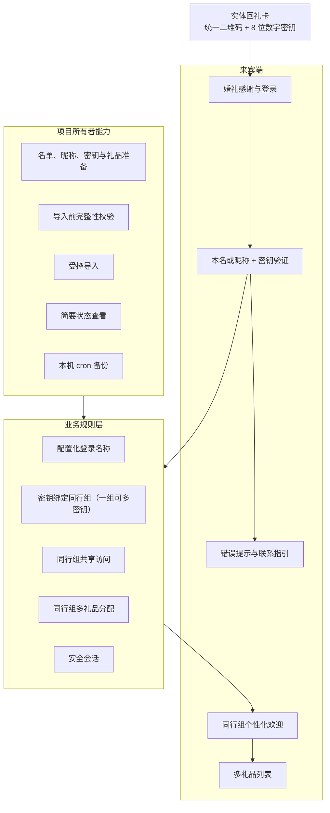
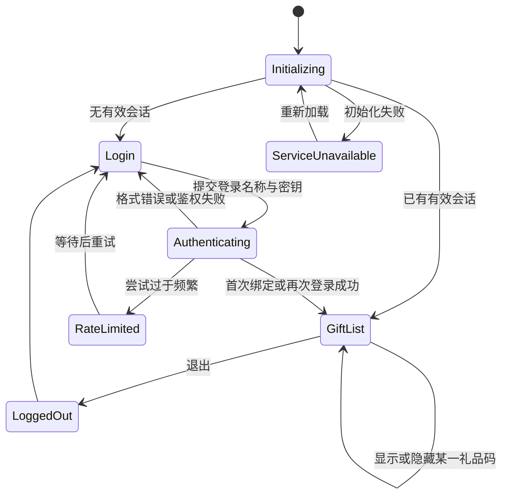
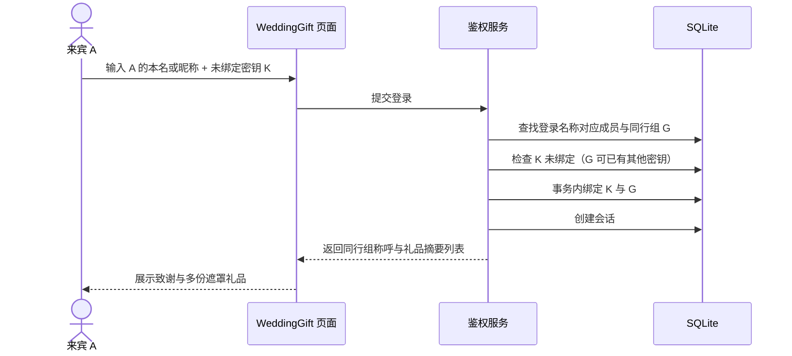
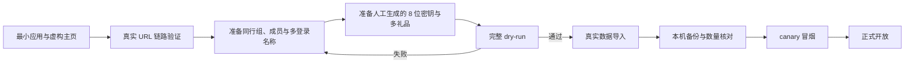

<!--
文档名称: WeddingGift 产品架构设计
文档类型: 产品设计
版本: v1.4
日期: 2026-09-11
状态: 产品设计基线，已按小规模服务原则收敛
需求基线: docs/00-project-brief.md
-->

# WeddingGift 产品架构设计

## 目录

- [1. 产品定位](#1-产品定位)
- [2. 产品原则](#2-产品原则)
- [3. 产品能力架构](#3-产品能力架构)
- [4. 用户与权限](#4-用户与权限)
- [5. 信息架构与页面状态](#5-信息架构与页面状态)
- [6. 核心业务流程](#6-核心业务流程)
- [7. 鉴权决策规则](#7-鉴权决策规则)
- [8. 同行组、成员与登录名称](#8-同行组成员与登录名称)
- [9. 多礼品展示体验](#9-多礼品展示体验)
- [10. 视觉与交互规格](#10-视觉与交互规格)
- [11. 项目所有者工作流](#11-项目所有者工作流)
- [12. 异常与边界场景](#12-异常与边界场景)
- [13. 功能优先级](#13-功能优先级)
- [14. 产品验收标准](#14-产品验收标准)
- [15. 数据准备规范](#15-数据准备规范)
- [16. 待确认内容与默认决策](#16-待确认内容与默认决策)
- [17. 变更记录](#17-变更记录)

## 1. 产品定位

WeddingGift 不是通用礼品平台，而是一封带有私密领取能力的数字感谢信：来宾用自己的本名或日常昵称，加上实体卡上的 8 位密钥进入，只看到为其同行组准备的致谢和礼品列表。

产品应让用户感受到“被认真准备”，而不是“登录一个后台系统”。页面以感谢、祝福和礼品呈现为主，身份校验保持克制、清晰和可信。

## 2. 产品原则

1. **先打通访问链路**：先让真实 URL 展示无真实数据的最小主页，再继续业务开发。
2. **一个成员，一个身份，多个登录名称**：本名与配置昵称都映射到同一成员，不复制用户数据。
3. **一个同行组，一个密钥**：一个密钥最多属于一个组，一个组最多拥有一个密钥。
4. **一个同行组，多份礼品**：同组成员看到相同礼品列表，每份礼品可独立显示和复制激活码。
5. **安全不制造困扰**：鉴权失败不泄漏姓名或密钥是否单独有效，但输入格式提示保持明确。
6. **移动端优先**：扫码、输入、查看、复制和跳转都能单手完成。
7. **轻量而稳定**：不使用大图、视频、第三方字体或追踪脚本。
8. **只建设必要能力**：不做公网后台、自动密钥生成、复杂补发、重审计、高可用或异机灾备；低频异常允许人工处理。

## 3. 产品能力架构



产品分为三个边界清晰的部分：

- **来宾端**：唯一公网用户界面；
- **业务规则层**：决定成员、登录名称、同行组、唯一密钥和礼品关系；
- **项目所有者能力**：通过受控命令行和离线数据文件使用，不提供公网入口。

## 4. 用户与权限

| 角色 | 可以做 | 不可以做 |
|---|---|---|
| 未登录来宾 | 查看欢迎页、提交本名/昵称和密钥、查看隐私说明 | 枚举名单、查询礼品、查看绑定状态 |
| 已登录来宾 | 查看本同行组致谢、逐份显示/复制本组礼品码、查看兑换说明、退出 | 查看其他组、修改绑定、修改名单或礼品 |
| 同行组其他成员 | 使用该组唯一密钥和自己的任一配置登录名称进入同一礼品列表 | 使用该密钥进入其他同行组 |
| 项目所有者 | 离线准备和导入数据、查看简要状态、停用密钥、执行本机备份、人工处理异常 | 通过公网管理接口操作；在日志中查看明文密钥或礼品码 |

## 5. 信息架构与页面状态

### 5.1 单页结构

公网只提供一个主页面，浏览器地址始终停留在 `/wedding/`，由页面状态切换完成体验，避免路径前缀下的跳转和资源定位问题。



礼品码的“已显示/已隐藏”是每张礼品卡片自己的局部状态；页面可同时存在任意数量的已显示礼品，不使用单一全局揭示状态。

### 5.2 页面区域

| 区域 | 登录前 | 登录后 |
|---|---|---|
| 品牌/婚礼抬头 | 新人称呼、日期或简短标记 | 不再保留顶部抬头；新人称呼与日期改为感谢信落款，居右收于致谢正文下方 |
| 主标题 | “谢谢你来见证我们的重要时刻”一类文案 | 使用同行组称呼的个性化感谢 |
| 主卡片 | 姓名或昵称、8 位卡片密钥、登录按钮 | 一到多张礼品卡片，每张含类型、说明、遮罩码和操作按钮 |
| 辅助信息 | 输入说明、隐私说明、联系提示 | 每份礼品的兑换步骤、有效期和可信兑换入口 |
| 页脚 | 备案号、服务用途、隐私简述 | 同左，增加退出入口 |

### 5.3 初始化策略

1. 页面加载后检查现有会话。
2. 检查期间展示短暂加载态，不闪现礼品信息。
3. 有效会话直接进入礼品列表；无会话进入登录态。
4. 会话失效时清除页面内所有明文礼品码并返回登录态。

## 6. 核心业务流程

### 6.1 首次正常登录



### 6.2 使用同一成员的不同登录名称

1. 成员 A 配置本名“张嘉明”和昵称“阿明”。
2. “张嘉明”与“阿明”都解析到同一成员 A 和同行组 G。
3. 首次使用任一名称绑定后，之后使用另一名称和同一密钥仍然成功。
4. 登录名称变化不会创建第二个用户、第二个密钥绑定或第二份礼品分配。

### 6.3 同行成员再次登录

以夫妻 A、B 为例：

1. A 首次使用密钥 K 登录，K 绑定到共同同行组 G。
2. B 之后输入自己的本名或配置昵称和 K。
3. 系统确认 B 也属于 G，因此登录成功。
4. A、B 看到相同致谢和完整礼品列表。

### 6.4 冲突绑定

- K 已绑定 G1，输入 G2 的任一登录名称：失败，K 仍属于 G1；访客端明确提示「密钥已被绑定，可联系新郎处理」。
- G1 已绑定 K1，再用未绑定 K2 配合 G1 的任一登录名称：绑定成功；K2 与 K1 看到同一份回礼（一个同行组可绑定多个密钥）。
- 名称或密钥无效的失败显示同一通用文案，不暴露具体校验细节。

### 6.5 首次使用他人姓名

1. K 尚未绑定，A 输入 B 的有效本名或昵称。
2. K 会绑定 B 所在同行组 G2（同组允许多个密钥）；被冒名的 B 本人之后仍可用自己的卡片密钥正常绑定 G2、看到同一份回礼。
3. 误绑无法由访客纠正；项目所有者根据实际情况停服后人工处理（如停用冒名密钥）。
4. 该风险已被接受，不增加手机号、身份证明或人工审批流程。

## 7. 鉴权决策规则

### 7.1 输入处理

- 登录名称：去除首尾空白、统一 Unicode 表示，按配置规则处理大小写；不做拼音、近似字或模糊匹配。
- 密钥：必须完整匹配 8 位 ASCII 数字，不接受空格、连字符、字母、全角数字或其他字符。
- 前端可以明确提示格式错误；提交后台后，名称或密钥无效统一模糊化，仅「密钥已绑定其他同行组」明确提示。

### 7.2 决策表

| 登录名称状态 | 密钥状态 | 组绑定状态 | 结果 | 数据变化 |
|---|---|---|---|---|
| 无效 | 任意 | 任意 | 通用鉴权失败 | 无 |
| 有效 | 无效/停用 | 任意 | 通用鉴权失败 | 无 |
| 有效，属 G | K 未绑定 | 任意（G 可已有其他密钥） | 成功 | 事务内绑定 K 与 G，创建会话 |
| 有效，属 G | K 已绑定 G | G 的密钥之一为 K | 成功 | 仅创建/刷新会话 |
| 有效，属 G1 | K 已绑定 G2 | 任意 | 明确的密钥已绑定失败（提示可联系新郎处理） | 无 |
| 有效 | 任意 | 请求被限流 | 稍后重试 | 无 |

### 7.3 绑定约束

项目运行时始终满足：

- 一个密钥的绑定目标数量为 0 或 1；
- 一个同行组的绑定密钥数量为 0 到多个（2026-09-13 起由一对一放宽，防止冒名首绑后本人无法补绑）；
- 一个成员只属于一个同行组；同组使用任一已绑定密钥登录看到的回礼完全相同；
- 多个登录名称只增加登录入口，不改变上述数量关系。

## 8. 同行组、成员与登录名称

### 8.1 数据表达

每个同行组配置：

- 内部组编号；
- 面向来宾的称呼，如“嘉明和若溪”；
- 至少一名成员，且至少一名成员允许登录；
- 每个成员唯一的本名、零到多个昵称、是否允许登录；
- 可选专属感谢短句；
- 一到多份礼品分配。

### 8.2 登录名称规则

- 所有朋友本名唯一，不设计同名处理分支。
- 可登录成员的本名自动成为一个登录名称。
- 日常昵称由配置显式添加，可为零个、一个或多个。
- 所有本名与昵称规范化后全局唯一；任何冲突都必须在导入前修正。
- 页面字段文案使用“你的名字或昵称”，避免暴露后台术语。

### 8.3 文案拼装

默认采用安全的纯文本字段，不允许数据文件注入 HTML。建议结构：

- 标题：`谢谢你们来见证我们的重要时刻`
- 称呼：`致 嘉明和若溪`，居左置于页面偏上位置。
- 正文：全局统一感谢文案；若配置专属短句，在其后单独展示。
- 落款：新人称呼居右，婚礼日期紧随其后，如「赵伟 & 刘子璇 / 2026-09-26」。

不根据“单身/夫妻/带娃”写程序判断文案，而由同行组称呼和成员配置自然表达。

## 9. 多礼品展示体验

### 9.1 展示层级

1. 同行组个性化致谢；
2. 礼品数量提示，例如“为你们准备了 3 份礼物”；
3. 按配置顺序排列的一到多张礼品卡片；
4. 每张卡片展示礼品名称、简短说明和默认遮罩的激活码；
5. 每份礼品独立提供“显示”“复制”“隐藏”；
6. 兑换步骤、有效期和可选官方兑换链接；
7. 遇到问题时的联系说明。

### 9.2 激活码交互

- 初次进入时所有礼品码均保持遮罩。
- 显示操作只对当前有效会话和本组礼品开放。
- 显示一份礼品不应自动显示其他礼品。
- 复制成功使用文字状态反馈；剪贴板 API 不可用时允许长按选择复制。
- 退出、会话过期或页面刷新后重新遮罩全部明文。
- 不把激活码写入 URL、浏览器持久存储、统计脚本或错误日志。

### 9.3 礼品类型配置

旅游年卡、电影券和咖啡券共享统一礼品卡组件。礼品类型配置提供：

- 类型编号；
- 礼品名称与副标题；
- 默认兑换步骤；
- 默认有效期说明；
- 默认 HTTPS 官方兑换链接；
- 小型图形标识或主题色变体。

单份礼品可以按实际券信息覆盖默认兑换步骤、有效期或链接。新增礼品类型应以新增配置为主，不修改鉴权、密钥绑定和会话流程。

## 10. 视觉与交互规格

### 10.1 视觉关键词

- **温馨**：柔和暖白背景和自然留白；
- **浪漫**：登录页以一张半透明新人合照作柔化背景（向上半显、向下渐隐融入底色，不单独占据区域），顶部两片 8%/15% 灰粉酒红帷幕曲面如轻薄布料折光，视口四角分散低饱和线稿（花枝/碰杯/爱心），登录页另有少量慢速坠落花瓣；不使用大幅高清婚纱照片；
- **简约**：单列布局、清晰信息层级；
- **高级**：低饱和香槟金、灰粉和深墨色，细边框与克制阴影。

### 10.2 设计令牌基线

| 类别 | 基线 |
|---|---|
| 背景 | 暖象牙 `#F7F3ED`，可叠加不影响阅读的浅暖渐变 |
| 表面 | 卡片 `#FFFCF8`，半透明装饰不得降低正文对比度 |
| 主文字 | 深墨灰 `#292625` |
| 次文字 | 暖灰 `#6F6864` |
| 品牌强调 | 灰粉酒红 `#8B5E66` |
| 装饰/边框 | 香槟金 `#B99A6A`，不单独承载信息 |
| 成功/错误 | 墨绿 `#47685A` / 砖红 `#9A4F4F`，同时配文字说明 |
| 字号 | 正文和输入框至少 16 px；标题按 28/24/20 px 分级 |
| 间距 | 4/8/12/16/24/32/48 px 刻度 |
| 圆角/阴影 | 卡片 20 px、控件 12 px；一层低透明暖灰阴影 |
| 内容宽度 | 手机左右至少 20 px；主区域最大宽度 560 px |

所有正文和按钮文字满足 WCAG AA 对比度；香槟金只用于线条、图标和小面积装饰。

### 10.3 移动端低保真布局

```text
┌──────────────────────────────┐
│  新人称呼 · 婚礼日期          │
│                              │
│  谢谢你来见证我们的重要时刻   │
│                              │
│  ┌────────────────────────┐  │
│  │ 你的名字或昵称          │  │
│  │ [                    ] │  │
│  │ 8 位卡片密钥          │  │
│  │ [ _ _ _ _ _ _ _ _  ] │  │
│  │ [       查看礼物       ] │  │
│  │ 统一错误 / 等待提示     │  │
│  └────────────────────────┘  │
│  隐私短说明 · 联系提示         │
│  备案号                       │
└──────────────────────────────┘
```

登录后沿用同一视觉容器，替换为“同行组称呼 → 感谢文案 → 礼品卡片列表 → 退出”。多份礼品纵向排列，不使用横向滑动隐藏内容。

### 10.4 字体、资产与动效

- 使用系统中文字体栈，避免 1 Mbps 出口下载 Web Font。
- 装饰优先使用 CSS 和内联 SVG 线稿；位图仅登录页一张半透明合照背景（`web/assets/photos/couple.jpg`，2x 宽 ≤ 960 px、≤ 60 KB，本地嵌入；缺失时静默无背景），不加载视频。
- 所有触控目标不小于 44×44 px；输入框至少 16 px，避免 iOS 自动缩放。
- 动效以 120–220 ms 淡入和复制反馈为主；登录页少量慢速坠落花瓣（5 片、15–21 s 循环、低透明）为例外循环动画，遵循 `prefers-reduced-motion`（此时花瓣静止不可见）。
- 微信 WebView 无剪贴板权限时，礼品码切为可选择文本并提示长按复制。

## 11. 项目所有者工作流

首版使用同一应用二进制提供的少量本地命令行能力，不建设公网管理后台。

### 11.1 开发与上线顺序



真实 URL 链路验证阶段只展示虚构或固定占位内容，不导入真实姓名、昵称、密钥和礼品码。

### 11.2 必需管理能力

| 能力 | 说明 |
|---|---|
| `data validate` | 只读校验数据文件；报告字段缺失、登录名称冲突、非法 8 位密钥、重复密钥/激活码、无礼品组和非法链接 |
| `data import` | 校验通过后事务化导入；重复运行结果可预测，不静默重复 |
| `status` | 输出组、成员、登录名称、礼品、未绑定/已绑定/停用密钥数量等脱敏统计；组明细按 external_ref 列出组称呼、成员数、active 礼品数、礼品类型与已绑定密钥数，便于直观识别是哪个同行组、这组有什么礼（仍不含成员姓名、明文密钥与礼品码） |
| `key revoke` | 停用遗失或泄漏密钥，并使相关会话失效 |
| `backup create` | 由宿主机 cron 调用，创建本机 SQLite 一致性备份 |

不提供系统密钥生成、自动补发、恢复纪元、复杂交付 spool 或公网管理接口。少量误绑和数据错误由项目所有者停服、备份后人工修正。

### 11.3 数据安全纪律

- 含真实姓名、昵称、明文卡片密钥和明文礼品码的源文件放在 Git 之外。
- 密钥由项目所有者离线生成和保管；系统只导入并保存带服务端秘密的摘要。
- 导入完成后删除服务器临时明文文件，或转移回项目所有者控制的离线位置。
- 状态报告默认只显示内部编号和数量，不显示明文密钥或礼品码。

## 12. 异常与边界场景

| 场景 | 产品行为 |
|---|---|
| 登录名称为空或密钥不是 8 位数字 | 前端就地提示具体格式问题，不发请求 |
| 本名/昵称或密钥身份校验失败 | 统一提示“名字或卡片密钥不正确，请检查卡片后重试” |
| 昵称与其他成员登录名称冲突 | 数据预检失败，不能导入 |
| 已绑定密钥搭配其他组登录名称 | 明确提示「密钥已被绑定，可联系新郎处理」，不透露绑定目标 |
| 未绑定密钥搭配已有密钥的组 | 绑定成功；与既有密钥看到同一份回礼 |
| 两组近同时使用同一新密钥 | 绑定事务保证最多一个组成功 |
| 两个密钥近同时尝试同一组 | 两者都绑定成功（一个同行组允许多个密钥） |
| 同组成员使用本名或不同昵称 | 都解析到对应成员并进入同一礼品列表 |
| 某组有多份礼品 | 按配置顺序显示全部礼品，每份独立揭示和复制 |
| 礼品配置缺失或无法读取 | 显示“礼物信息暂时无法读取”和联系指引，不展示脏数据 |
| 会话过期 | 回到登录态并清空全部明文礼品码 |
| 密钥被项目所有者停用 | 新登录失败，已有会话在下次请求时失效 |
| 发生误绑或名单错误 | 不向访客提供纠错入口；项目所有者停服后人工检查和修正 |
| 浏览器不支持剪贴板 API | 明文可聚焦选择，并提示长按复制 |
| 服务进入维护或到期状态 | 显示统一说明和联系信息，不暴露底层错误 |

## 13. 功能优先级

### P0：上线必需

- 真实 URL 最小主页访问链路；
- 本名/多昵称登录名称校验；
- 8 位数字密钥导入、绑定、同组再次登录、跨组已绑定明确提示和同组多密钥；
- 安全会话、退出和简单限流；
- 同行组称呼与个性化；
- 多礼品查询、遮罩、显示、复制和兑换说明；
- 三种首批礼品类型及配置扩展能力；
- 数据校验/导入、状态查询和密钥停用；
- 移动端适配、通用错误态、备案和隐私说明；
- 基础安全控制、健康检查、本机 cron 备份和资源限制；
- 部署、回滚与拆除清单。

### P1：有余量时完成

- 个别同行组专属感谢短句；
- 页面切后台后的自动重新遮罩；
- 礼品有效期临近提示；
- 维护模式和到期感谢页。

### P2：本期不规划

- 公网管理后台；
- 商家核销同步；
- 多语言；
- 行为分析面板；
- 自动密钥生成、补发或访客自助改绑；
- COS、主从、高可用、自动灾难恢复或审计平台。

## 14. 产品验收标准

| 编号 | 前置条件 | 操作 | 预期结果 |
|---|---|---|---|
| PA-01 | 最小应用已部署，无真实数据 | 访问 `https://stg.costra.cloud/wedding/` | 主页、静态资源和健康链路正常，Costra 原路径不受影响 |
| PA-02 | A 配置本名和两个昵称 | 分别使用三个名称登录 | 都识别为成员 A，返回相同同行组和礼品列表 |
| PA-03 | 任一登录名称与其他成员名称冲突 | 执行数据预检 | 预检失败且数据库零写入 |
| PA-04 | 姓名属 G，K 有效且未绑定 | 首次登录 | K 与 G 建立绑定，用户进入礼品列表 |
| PA-05 | K 已绑定 G，A/B 都属于 G | 分别用各自本名或昵称 + K 登录 | 均成功且看到相同礼品列表 |
| PA-06 | K 已绑定 G1 | 用 G2 登录名称 + K 登录 | 失败且无数据修改，明确提示密钥已被绑定、可联系新郎处理 |
| PA-07 | G 已绑定 K1 | 用未绑定 K2 + G 的登录名称登录 | 成功，K2 绑定 G，与 K1 看到完全相同的回礼 |
| PA-08 | K 未绑定 | G1、G2 近同时首次登录 | 最多一个组成功，K 最多一个绑定目标 |
| PA-09 | G 已有绑定 | K1、K2 近同时配合 G 登录 | 两个密钥都成功绑定 G |
| PA-10 | G 配置旅游年卡、电影券、咖啡券，其中一份覆盖默认有效期或链接 | 登录后查看礼品 | 三份均按顺序显示，实例覆盖生效，且可分别揭示、复制和隐藏 |
| PA-11 | 新增一种配置化礼品类型 | 导入并登录 | 无需修改鉴权流程即可展示 |
| PA-12 | K 被停用 | 尝试登录或继续使用既有会话 | 登录失败，既有会话失效 |
| PA-13 | 输入错误 | 多次提交 | 出现一致错误与基础限流反馈，不能枚举有效名称/密钥 |
| PA-14 | 常见手机和微信浏览器 | 从二维码进入并完整操作 | 无根路径 404、无横向滚动、按钮可操作、复制有降级 |
| PA-15 | cron 到达计划时间 | 检查自有备份目录 | 产生新的本机 SQLite 一致性备份，旧备份按 72 份轮转 |

## 15. 数据准备规范

建议用表格维护、导出为 UTF-8 CSV 数据包；最终字段以技术数据契约为准。

| 数据表 | 关键内容 | 上线前校验 |
|---|---|---|
| 同行组 | 内部编号、来宾称呼、可选专属短句、启用状态 | 编号唯一、称呼非空 |
| 成员 | 成员编号、组编号、唯一真实姓名、是否可登录 | 组存在；真实姓名规范化后全局唯一；每组至少一人可登录 |
| 登录名称 | 成员编号、名称、类型（本名/昵称） | 成员存在；每位可登录成员有本名；所有名称规范化后全局唯一 |
| 礼品类型 | 类型编号、标题、副标题、默认兑换步骤、默认有效期、默认官方链接、主题 | 至少包含旅游年卡、电影券、咖啡券；链接仅允许 HTTPS |
| 礼品实例 | 礼品编号、组编号、类型编号、明文激活码、可选兑换步骤/有效期/链接覆盖、排序 | 每组至少一份；编号和激活码不重复；类型存在；覆盖链接仅允许 HTTPS |
| 卡片密钥 | 卡片编号、8 位明文密钥 | 卡片编号唯一；严格 8 位 ASCII 数字；密钥全局唯一；不预填组编号 |

正式导入前生成一份不含明文密钥和激活码的核对报告，至少包含：组数、成员数、登录名称数、礼品数、卡片数、各礼品类型数量、每组礼品数量、缺失项和重复项。

## 16. 待确认内容与默认决策

| 待确认项 | 当前默认值 | 影响时点 |
|---|---|---|
| 新人称呼、婚礼日期与最终感谢文案 | 使用占位文本，开发时配置化 | 视觉实现前 |
| 儿童是否可作为登录成员 | 默认不可登录，只参与称呼 | 数据导入前 |
| 会话时长 | 7 天闲置过期、30 天绝对过期 | 鉴权实现前 |
| 礼品码页面切后台后何时重遮罩 | 页面刷新或会话结束时 | 前端实现前 |
| 联系方式 | 默认展示一条不含公开手机号的联系文案 | 上线前 |
| 服务关闭日期 | 约 3 个月，精确日期待定 | 部署前 |
| 本机备份时间 | 每小时 03:44 等 `:44` 时刻（独立 `/etc/cron.d/wedding`），避开共享机器已知任务窗口 | 上线前 |
| 个别组专属感谢语 | 可选字段，未配置则使用全局文案 | 数据准备时 |

这些待确认项不改变产品主架构，可按默认值开始开发；真实数据导入和正式开放前完成最终确认。

## 17. 变更记录

| 版本 | 日期 | 变更内容 |
|---|---|---|
| v1.6 | 2026-09-13 | 婚礼视觉定稿（§10.1/§10.4）：登录页半透明合照背景（半显渐隐、不单独占区）、顶部 8%/15% 灰粉酒红双帷幕曲面、视口四角线稿（花枝/碰杯/爱心）、登录页少量慢速坠落花瓣；§10.4 资产条款由「不加载照片」修订为「仅登录页一张压缩合照背景」 |
| v1.5 | 2026-09-13 | 绑定约束放宽：一个密钥仍最多绑定一个同行组，一个同行组改为可绑定多个密钥（PA-07/PA-09 反转）；「密钥已绑定其他同行组」从通用鉴权失败改为明确提示可联系新郎处理（PA-06） |
| v1.4 | 2026-09-11 | 本机备份默认值改为每小时 `:44` 触发、保留 72 份（PA-15 与待确认项同步）；cron 以独立 `/etc/cron.d/wedding` 落地 |
| v1.3 | 2026-09-11 | 删除同名处理；支持本名和多个昵称映射同一成员；密钥改为人工生成的 8 位数字并与同行组一对一；首版支持多礼品和三种类型；收敛管理、审计与备份能力；增加真实 URL 最小主页阶段 |
| v1.2 | 2026-09-11 | 完成原始产品架构基线 |
