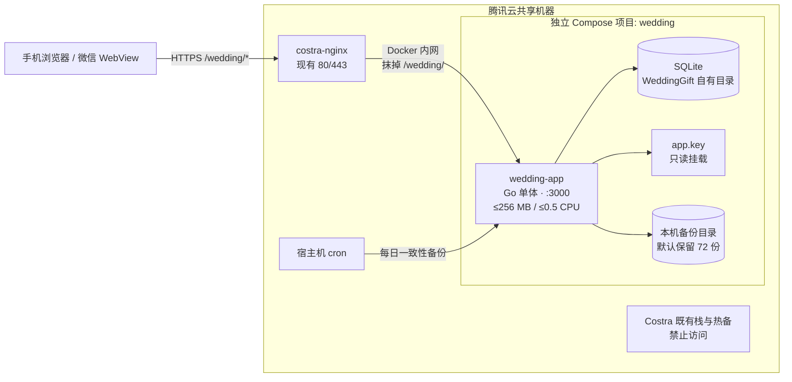
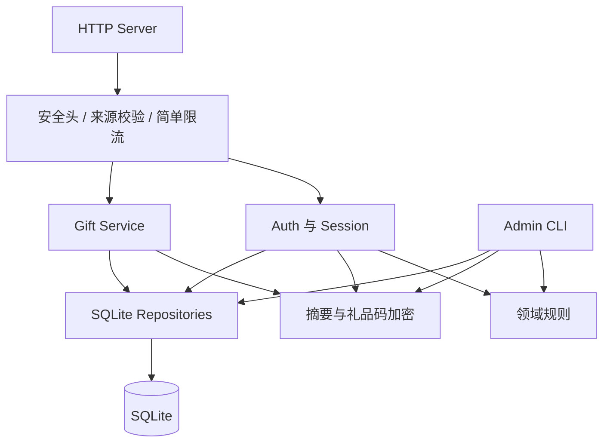
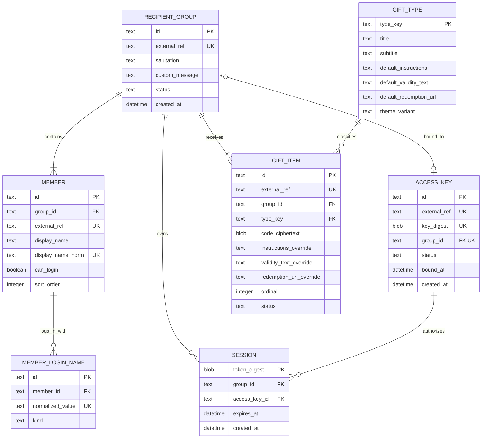
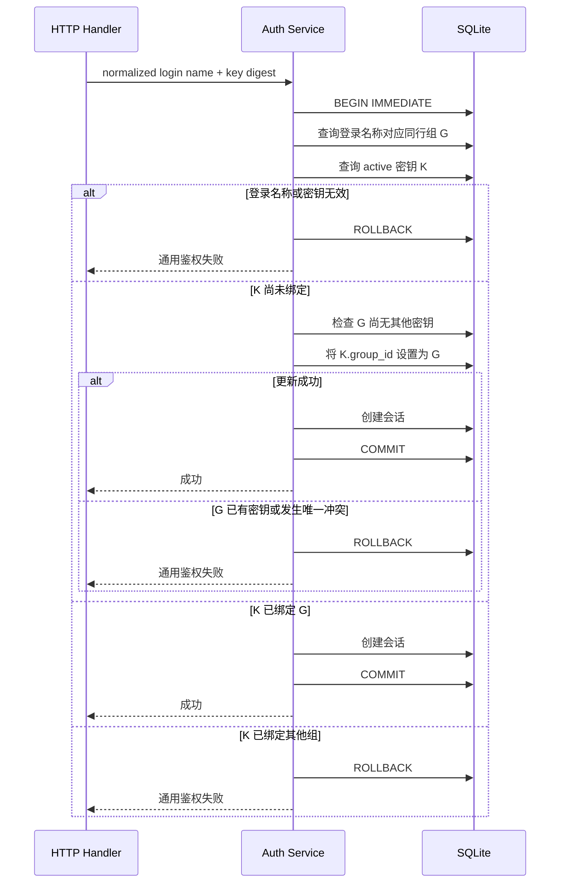
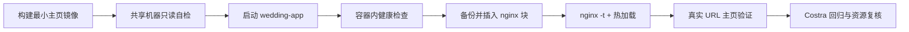

<!--
文档名称: WeddingGift 技术架构设计
文档类型: 技术设计 / 架构决策
版本: v1.8
日期: 2026-09-12
状态: 推荐架构基线，按小规模单机服务原则实施
需求基线: docs/00-project-brief.md
产品设计: docs/01-product-architecture.md
部署约束: staging-machine-brief.md
-->

# WeddingGift 技术架构设计

## 目录

- [1. 架构目标与简化原则](#1-架构目标与简化原则)
- [2. 核心架构决策](#2-核心架构决策)
- [3. 系统拓扑](#3-系统拓扑)
- [4. 技术栈与应用模块](#4-技术栈与应用模块)
- [5. 代码目录蓝图](#5-代码目录蓝图)
- [6. 数据架构](#6-数据架构)
- [7. 登录名称与密钥处理](#7-登录名称与密钥处理)
- [8. 一对一绑定算法](#8-一对一绑定算法)
- [9. HTTP 与前端设计](#9-http-与前端设计)
- [10. 必要安全设计](#10-必要安全设计)
- [11. 数据导入与管理命令](#11-数据导入与管理命令)
- [12. 真实 URL 访问链路](#12-真实-url-访问链路)
- [13. 容器与共享机器部署](#13-容器与共享机器部署)
- [14. 本机备份与轻量运维](#14-本机备份与轻量运维)
- [15. 日志与健康检查](#15-日志与健康检查)
- [16. 测试策略](#16-测试策略)
- [17. 发布、回滚与拆除](#17-发布回滚与拆除)
- [18. 威胁模型与接受风险](#18-威胁模型与接受风险)
- [19. 明确不采用的设计](#19-明确不采用的设计)
- [20. 实施门禁](#20-实施门禁)
- [21. 变更记录](#21-变更记录)

## 1. 架构目标与简化原则

WeddingGift 的技术方案按以下顺序取舍：

1. **核心功能正确**：本名/昵称映射同一成员；密钥与同行组一对一；同组可有多份礼品。
2. **先验证真实链路**：在业务功能开发前，让最小主页通过 `https://stg.costra.cloud/wedding/` 可访问。
3. **必要安全**：8 位密钥不可明文入库，礼品码加密保存，日志不记录敏感值，登录有基础限流。
4. **共享机器边界**：不使用、不探测、不挂载 Costra 的数据库、Redis、备份和文件。
5. **保持简单**：单应用、单 SQLite、单实例、本机 cron 备份；低频异常允许人工停服处理。
6. **数据驱动**：同行结构、成员昵称、礼品数量和礼品类型均由配置决定。

本项目没有性能、并发或数据量压力。除保证一次绑定事务的一致性外，不为理论上的高负载、跨机故障或复杂审计建设额外系统。

## 2. 核心架构决策

| 编号 | 决策 | 理由 |
|---|---|---|
| ADR-001 | 使用 Go 单体应用 | 单二进制、运行资源低、部署和命令行工具简单 |
| ADR-002 | 使用 SQLite，且只运行一个应用实例 | 数据量和并发极小；事务和唯一约束足以保证核心绑定规则 |
| ADR-003 | 使用服务端托管的 HTML/CSS/原生 JavaScript | 不引入前端框架和 CDN，保持资源轻量与路径简单 |
| ADR-004 | 同一二进制提供 HTTP 服务和少量管理子命令 | 复用校验和数据访问，不建设公网后台 |
| ADR-005 | 本名和昵称存为独立登录名称记录，统一指向成员 | 自然支持一个成员多个登录入口，避免复制用户 |
| ADR-006 | `access_keys.group_id` 可空且唯一 | 一行即可表达未绑定或已绑定；保证一个密钥一个组、一个组一个密钥 |
| ADR-007 | 密钥由项目所有者生成，系统只校验、导入和摘要存储 | 满足 8 位数字规则，删除生成器和交付状态机 |
| ADR-008 | 礼品直接归属同行组，一组可有多条礼品记录 | 同一密钥登录后自然得到完整礼品列表 |
| ADR-009 | 一个应用主秘密派生密钥摘要与礼品加密用途 | 保留必要安全，避免多 keyring、轮换和恢复流程 |
| ADR-010 | 使用服务端随机会话，不使用 JWT | 可退出和停用，浏览器不持有业务声明 |
| ADR-011 | 代理抹掉 `/wedding/`，前端只使用相对 URL | 与既定 nginx 接入方式一致，避免根路径错误 |
| ADR-012 | 每小时由宿主机 cron 创建本机 SQLite 一致性备份 | 满足当前风险承受能力，不增加 COS 或异机恢复链路 |
| ADR-013 | 运行日志替代独立审计系统 | 使用人数少且可人工介入，不建设审计表、留存平台或告警系统 |

## 3. 系统拓扑



边界规则：

- 不发布宿主机端口，不使用 host network；
- 不携带 Costra 凭据、连接串或客户端配置；
- 只挂载 `/data/wedding/` 下的自有数据、秘密和备份；
- nginx 只按 `staging-machine-brief.md` 插入 WeddingGift location；
- Costra 已有主从和热备是共享机器事实，与 WeddingGift 数据架构无关。

已知残余风险：

- `wedding-app` 为接受反代必须加入 `costra_default`，与同网 Costra 容器在网络层可达；通过无凭据、无客户端、挂载白名单和最小权限降低误用风险。
- `/wedding/` 与 Costra 其他路径共享同一 HTTPS origin；路径和 Cookie Path 不是强安全隔离。上线前必须复核根作用域 Service Worker、同源可执行内容和 Costra XSS 风险。

## 4. 技术栈与应用模块

### 4.1 技术栈

- Go 当前受支持稳定版本；开始实现时固定精确版本。
- 标准库 `net/http`、`html/template`、`crypto/*`、`database/sql`。
- 轻量纯 Go SQLite 驱动，避免 CGO 与运行镜像系统库耦合。
- 嵌入式 SQL migration；不运行常驻迁移服务。
- 语义化 HTML、原生 CSS、少量原生 JavaScript ES module。
- 静态资源通过 `go:embed` 编译进二进制。
- 结构化 JSON 日志输出到 stdout/stderr，由 Docker 轮转。

### 4.2 应用模块



| 模块 | 职责 |
|---|---|
| HTTP Server | 路由、JSON 编解码、超时、静态资源和统一响应 |
| Middleware | 请求 ID、安全响应头、来源校验、请求体限制、简单限流和会话解析 |
| Auth | 登录名称查询、密钥校验、一对一绑定事务、会话创建和退出 |
| Gift | 返回本组礼品摘要列表，按礼品逐项解密激活码 |
| Domain | 同行组、成员、登录名称、密钥和礼品的不变量 |
| Crypto | 密钥 HMAC、礼品码 AEAD、会话令牌摘要和随机数 |
| Store | 参数化 SQL、migration、短事务和健康查询 |
| Admin CLI | 数据校验/导入、状态、密钥停用和本机备份 |

不再拆分恢复纪元、凭据交付、审计平台、远端备份客户端或复杂密钥轮换模块。

## 5. 代码目录蓝图

```text
WeddingGift/
├── cmd/
│   └── wedding/                 # serve 与 admin 子命令入口
├── internal/
│   ├── app/                     # 生命周期、依赖装配、配置
│   ├── auth/                    # 登录、一对一绑定、会话
│   ├── gift/                    # 多礼品查询与按需显示
│   ├── admin/                   # 校验、导入、状态、停用、备份
│   ├── domain/                  # 实体与不变量
│   ├── cryptox/                 # HMAC、AEAD、随机令牌
│   ├── store/                   # SQLite repository 与事务
│   └── httpx/                   # handler 与 middleware
├── migrations/                  # SQL migration
├── web/
│   ├── index.html
│   └── assets/                  # CSS、JS、小型 SVG
├── testdata/                    # 仅虚构数据
├── deploy/                      # compose 与 WeddingGift nginx 片段
├── ops/                         # 部署、本机备份、回滚、拆除
├── docs/
├── go.mod
├── go.sum
└── Dockerfile
```

规则：

- `internal/domain` 不依赖 HTTP 或 SQLite。
- `testdata` 只包含虚构姓名、昵称、密钥和礼品码。
- `deploy/` 只保存 WeddingGift 自有配置和 nginx 插入片段，不复制 Costra 全量配置。
- `ops/` 只能操作 `/opt/wedding`、`/data/wedding`、WeddingGift 容器、`/etc/cron.d/wedding` 单元和说明书允许的 nginx 插入块。
- WeddingGift 全部产出收束到 `/opt/wedding/`（代码/部署物）与 `/data/wedding/`（运行时数据），日志走 Docker json-file，不散落其他位置。

## 6. 数据架构

### 6.1 实体关系



### 6.2 关键约束

数据库约束和导入校验共同保证：

1. `MEMBER.display_name_norm` 全局唯一；不为同名设计额外字段或流程。
2. 每位可登录成员至少有一个 `MEMBER_LOGIN_NAME`，其中必须包含本名。
3. `MEMBER_LOGIN_NAME.normalized_value` 全局唯一；本名和所有昵称不能指向不同成员。
4. 每个成员只属于一个同行组，每个启用同行组至少有一名可登录成员。
5. `ACCESS_KEY.key_digest` 全局唯一；明文密钥不入库。
6. `ACCESS_KEY.group_id` 可空且具有唯一约束，因此密钥和同行组两侧都是 0 或 1 的关系。
7. 每个启用同行组至少一份有效礼品，允许多份；`ordinal` 决定展示顺序。
8. 礼品类型通过外键引用配置，首批内置旅游年卡、电影券和咖啡券，可继续增加；类型提供默认兑换说明、有效期和链接，礼品实例可按实际情况覆盖这些字段。
9. 被停用密钥不能创建会话；停用时删除其有效会话。
10. 时间统一以 UTC 存储。

### 6.3 SQLite 设置

保持可理解的最小配置：

```sql
PRAGMA foreign_keys = ON;
PRAGMA journal_mode = WAL;
PRAGMA synchronous = NORMAL;
PRAGMA busy_timeout = 5000;
```

同时：

- 仅运行一个应用实例；连接池保持小规模，例如最多 4 个连接。
- 数据目录权限 `0700`，数据库、秘密和备份文件权限 `0600`；`data`/`backups`/`secrets` 目录及其中文件属主为容器运行用户 65534。
- 所有 SQL 参数化；绑定写事务保持短小，不在事务内做网络或文件操作。
- migration 在发布时由同版本二进制显式执行；失败即停止发布。
- 不设置复杂 page cap、审计容量、自动 vacuum 策略或多版本恢复守卫；本项目数据量可直接人工观察。
- 运行中备份使用 SQLite online backup API，不直接复制活跃的数据库及 WAL 文件。

## 7. 登录名称与密钥处理

### 7.1 登录名称规范化

导入和登录共用一个简单、版本固定的函数：

1. 去除首尾空白；
2. 统一 Unicode NFC；
3. 若未来允许拉丁字母昵称，统一大小写；
4. 不删除姓名内部字符，不做拼音、繁简转换、错别字或近似匹配。

本名和昵称规范化后直接存入 `MEMBER_LOGIN_NAME.normalized_value` 并做唯一索引。姓名数据量极小，且项目所有者已确认本名唯一，因此不引入姓名 HMAC 索引。数据库文件权限、访问边界和日志脱敏承担基础隐私保护。

### 7.2 8 位密钥校验与存储

```text
rawKey 必须匹配 ^[0-9]{8}$
keyDigest = HMAC-SHA256(K_access_lookup, rawKey)
```

- 只接受 ASCII `0`–`9`，不自动删除空格或连字符。
- 8 位数字只有约 26.6 bit 空间，不能使用普通 SHA-256 等可离线穷举摘要。
- `K_access_lookup` 从 `/data/wedding/secrets/app.key` 派生，明文密钥只存在于项目所有者离线源文件和一次导入过程。
- 系统不生成、打印或导出新密钥。

## 8. 一对一绑定算法

### 8.1 原子流程



### 8.2 实现约束

- `BEGIN IMMEDIATE` 和 `UNIQUE(access_keys.group_id)` 同时保护一对一关系。M4 落地方式：`database/sql` 的 `BeginTx` 对 SQLite 是 DEFERRED 事务，因此 `store.BeginImmediate` 在专用连接上显式执行 `BEGIN IMMEDIATE`/`COMMIT`/`ROLLBACK`，语义与 `sql.Tx` 等价且拿到写锁后才开始读写。
- 首次绑定使用带条件的 `UPDATE`，只允许从 `group_id IS NULL` 变为目标组。
- 访客请求永不修改非空 `group_id`，也不提供解绑接口。
- 同一请求重试不会产生第二条绑定；提交后断网时，使用同组信息重试仍成功。
- 失败响应不区分登录名称无效、密钥无效、跨组或目标组已有密钥。
- 虽然没有并发压力，仍保留两个请求争抢同一密钥或同行组的集成测试，以验证数据库不变量，而不是建设高并发系统。
- 极少量误绑由项目所有者停服、创建本机备份后人工修正；修正后必须重新运行唯一约束和数据完整性检查。

## 9. HTTP 与前端设计

### 9.1 公网路由

nginx 把浏览器的 `/wedding/...` 映射成应用内部 `/...`。

| 方法 | 应用内部路径 | 浏览器实际路径 | 作用 | 鉴权 |
|---|---|---|---|---|
| `GET` | `/` | `/wedding/` | 返回单页主页 | 否 |
| `GET` | `/assets/{file}` | `/wedding/assets/{file}` | 指纹化静态资源 | 否 |
| `GET` | `/api/bootstrap` | `/wedding/api/bootstrap` | 服务状态、当前会话、同行组与礼品摘要 | 可选会话 |
| `POST` | `/api/auth/login` | `/wedding/api/auth/login` | 校验并绑定/登录 | 来源校验 + 限流 |
| `POST` | `/api/auth/logout` | `/wedding/api/auth/logout` | 撤销当前会话并清 Cookie | 会话 |
| `POST` | `/api/gifts/reveal` | `/wedding/api/gifts/reveal` | 按 `giftId` 返回本组某份礼品码 | 会话 + 来源校验 |
| `GET` | `/healthz` | `/wedding/healthz` | 进程与 SQLite 只读健康检查 | 通用状态 |

使用 `POST` 揭示礼品码，避免预取和普通缓存触发。`giftId` 必须再次校验属于当前会话同行组，不能只信任前端列表。M5 落地：`internal/gift` 负责归属校验与逐份解密；不存在/跨组/已停用统一 `404 + gift_unavailable` 同一响应体，无会话或会话失效 `401 + session_invalid` 并清 Cookie；响应一律 `no-store`（由统一 JSON 写出保证）。

### 9.2 请求与响应规则

- API 只接受预期方法和 `application/json`；请求体上限 8 KB。nginx 层 `client_max_body_size 2m`（见 `staging-machine-brief.md §6.2`）只是外层粗粒度防护，应用层对 JSON body 另设 8 KB 硬上限，两者是纵深防御而非冲突：nginx 先挡超大异常请求，应用再对合法业务体做严格约束。
- JSON decoder 拒绝未知字段。
- 登录失败统一返回相同状态码、业务码和文案。
- 敏感接口设置 `Cache-Control: no-store`。
- API 不启用 CORS，只接受预期 `Host` 和同源 `Origin`。
- 不向客户端返回 SQL、堆栈、内部 ID 或密钥状态。

### 9.3 前端与路径前缀

- 浏览器只停留在 `/wedding/`，不启用 History API 路由。
- HTML 使用 `assets/app.css`、`assets/app.js` 等相对地址。
- JavaScript 使用 `api/bootstrap`、`api/auth/login` 等相对请求。
- 不发出指向域名根路径的重定向或资源请求。
- 二维码编码精确 URL `https://stg.costra.cloud/wedding/`。
- 多份礼品以纵向卡片列表展示，每份单独揭示和复制。

### 9.4 会话 Cookie

```text
Name: wedding_session
Secure: true
HttpOnly: true
SameSite: Lax
Path: /wedding/  （由 nginx `proxy_cookie_path / /wedding/` 统一收编；应用侧无需再设 Path，若框架强设则设 /wedding/）
```

- Cookie 只保存至少 256 bit 的随机令牌；数据库存令牌 SHA-256 摘要。
- M4 已按本节授权收敛为**固定 30 天有效期**（`auth.SessionTTL`），不做滑动续期：覆盖完整婚礼窗口且实现最简；令牌值以 base64url 编码放入 Cookie。
- 每次读取会话时确认关联密钥仍为 active（同时校验同行组仍为 active）。
- 不使用 `localStorage`、IndexedDB 或 Service Worker 保存会话与礼品码。

## 10. 必要安全设计

### 10.1 单一应用秘密

宿主机保存一个随机 `app.key`（属主容器用户 65534、权限 `0600`，所在 `/data/wedding/secrets` 目录属主 65534、权限 `0700`——容器以非 root 运行，root 属主的 `0700` 目录会阻止其读取），只读挂载给应用。程序使用 HKDF 派生：

- `K_access_lookup`：8 位卡片密钥 HMAC；
- `K_gift_code`：礼品激活码 AEAD 加密。

不建设多 keyring、在线轮换、交付加密或恢复纪元。服务周期短，`app.key` 由项目所有者保留一份离线副本；若秘密丢失，允许人工重建数据。注意：由于密钥以 HMAC 摘要、礼品码以 AEAD 密文存储，`app.key` 一旦丢失，数据库与本机备份中的密钥/礼品码都将无法验证或解密，备份也救不回。因此 `app.key` 的离线副本重要性等同于甚至高于数据库备份，应与真实源数据文件同等级别离线、异位保管。

### 10.2 礼品码与个人信息

- 礼品激活码使用标准 AEAD（如 AES-256-GCM）加密，每条记录使用独立随机 nonce。
- 本名、昵称、同行组称呼为满足直接查询和展示而以明文存在 SQLite 中；依靠文件权限、容器隔离、最小数据范围和到期删除保护。
- 明文姓名、昵称、卡片密钥和礼品码均不写日志。
- 真实数据源文件不进入 Git、镜像或无访问控制的位置。

### 10.3 登录防护

- JSON 内容类型、同源 `Origin`/`Host` 校验共同阻止普通跨站表单提交。M4 落地：`/api` 要求 Host 命中白名单（`WEDDING_ALLOWED_HOSTS`，默认 `stg.costra.cloud`，回环地址总是允许）；非 GET 请求必须携带 `Origin` 且其 host 与请求 Host 一致。
- 使用简单、有界的单实例内存限流：按来源 IP 和失败的密钥摘要限制登录尝试。
- 阈值以不误伤婚礼现场共享 NAT 为前提，M4 落地为单 IP 10 分钟 60 次失败、单密钥 10 分钟 10 次失败（滑动窗口，map 触顶 4096 键时整体清空该维度）。
- 应用重启后限流状态清空可以接受；不引入 Redis 或 CAPTCHA。

### 10.4 响应头和运行权限

至少设置：

```text
Content-Security-Policy: default-src 'self'; script-src 'self'; style-src 'self'; img-src 'self' data:; connect-src 'self'; object-src 'none'; base-uri 'none'; frame-ancestors 'none'; form-action 'self'
X-Content-Type-Options: nosniff
Referrer-Policy: no-referrer
Permissions-Policy: camera=(), microphone=(), geolocation=(), payment=()
X-Frame-Options: DENY
```

容器以非 root 用户运行，root filesystem 只读，drop all capabilities，设置 `no-new-privileges`。TLS 由现有 nginx 负责。

## 11. 数据导入与管理命令

同一 `wedding` 二进制提供以下必要命令：

```text
wedding serve
wedding migrate
wedding healthz-check
wedding data validate --dir <data-dir>
wedding data import --dir <data-dir>
wedding status
wedding key revoke --ref <card-ref>
wedding backup create --output <path>
```

约束：

- `healthz-check` 由 Docker healthcheck 调用：向本地 `serve` 端口发起一次 `/healthz` 请求，成功返回退出码 0、失败非 0；不依赖镜像内的 curl/wget，使镜像可用 distroless/scratch 精简基底。

- `data validate` 校验本名唯一、登录名称全局唯一、每位可登录成员有本名、8 位数字密钥唯一、每组至少一份礼品、礼品类型存在和 HTTPS 链接合法。
- `data import` 在应用停机时执行，先完整校验，再用一个事务写入；任一错误全部回滚。
- 明文密钥和礼品码从权限为 `0600` 的文件或 stdin 读取，不作为命令行参数。
- `status` 只显示内部编号和数量，不显示明文密钥或礼品码。
- `key revoke` 停用密钥并删除其会话，不自动生成替代密钥。
- 不提供 `keys generate`、自动补发、自动改绑、凭据交付 spool、恢复或复杂审计命令。
- 极少量特殊修正采用停服、先备份、人工 SQL/一次性脚本、完整性检查和重新启动的流程，不把它产品化为通用功能。

## 12. 真实 URL 访问链路

在数据、鉴权和礼品开发前增加独立阶段，只验证访问链路：

1. 构建仅包含主页和 `/healthz` 的最小应用镜像，不包含真实数据和业务秘密。
2. 在共享机器创建 WeddingGift 自有目录并启动容器。
3. 按 `staging-machine-brief.md` 备份并插入 `/wedding/` nginx location。
4. 执行 `nginx -t` 后热加载，禁止重启 Costra nginx。
5. 从外部浏览器和命令行访问 `https://stg.costra.cloud/wedding/`，确认 HTML、CSS/JS 相对路径和 HTTPS 正常。
6. 回归 Costra 原有关键路径、容器状态和资源占用。
7. 保存 nginx 片段和回滚材料；后续版本持续复用同一入口。

该阶段只证明 `浏览器 → HTTPS → costra-nginx → Docker 网络 → wedding-app` 可达，不导入真实姓名、昵称、密钥或礼品码，也不把“主页可访问”等同于业务已上线。

## 13. 容器与共享机器部署

### 13.1 目录边界

WeddingGift 全部产出收束到两处固定根目录，不散落其他位置：`/opt/wedding/` 存放代码与部署物，`/data/wedding/` 存放运行时数据；应用日志走 Docker json-file（stdout/stderr），不额外落地散乱日志文件。

| 路径 | 用途 | 规则 |
|---|---|---|
| `/opt/wedding/` | compose、镜像版本信息、部署与备份脚本、`/etc/cron.d/wedding` 片段与 nginx 插入片段的仓库副本 | 只属于 WeddingGift |
| `/data/wedding/data/` | SQLite 数据库 | `0700` 目录、数据库 `0600`，属主容器用户 65534 |
| `/data/wedding/backups/` | 本机 cron 备份 | 属主容器用户 65534；默认保留最近 72 份（≈3 天），不写入 Costra 目录 |
| `/data/wedding/secrets/` | `app.key` | `0700` 目录、`0600` 文件，属主容器用户 65534、只读挂载 |
| `/data/wedding/import/` | 临时导入文件 | 导入后删除或移回离线位置 |
| `/data/wedding/nginx/` | 修改前备份和 WeddingGift 片段 | 不覆盖 Costra 全量配置 |
| `/etc/cron.d/wedding` | WeddingGift 本机备份 cron 单元 | 独立文件；不修改 Costra 的 `costra-standby`/`costra-analyze`；拆除时删除 |

属主约定：`data`、`backups`、`secrets` 及其内容属主为容器运行用户 65534——bind mount 保留宿主机属主，容器内非 root 进程必须穿越目录并读写/读取这些文件，root 属主的 `0700` 目录会直接导致访问失败；`import`、`nginx` 及 `/data/wedding` 顶层保持 root（由 root 人工操作，不受 DAC 限制）。

绝不挂载 `/data/pgsql*`、`/data/redis`、`/data/slave`、`/data/conf/*.env` 或 Docker socket。

### 13.2 Compose 基线

- project name `wedding`，container name `wedding-app`；
- 只 `expose: 3000`，没有 `ports:`；
- external network `costra_default`，不声明自定义 subnet；
- `restart: unless-stopped`；
- 应用内存 hard limit 256 MB、CPU 0.5；
- `json-file` 日志 `max-size: 50m`、`max-file: 3`；
- 非 root、只读 rootfs、`tmpfs /tmp`、`cap_drop: ALL`、`no-new-privileges`；
- 仅数据和备份目录可写，secret 只读；
- 健康检查与合理停止宽限期。

### 13.3 nginx 操作纪律

严格复用 `staging-machine-brief.md §3/§6`：

1. 应用先在 Docker 内网启动并通过健康检查；
2. 备份 live conf 到 `/data/wedding/nginx/`；
3. 只插入 WeddingGift 两个 location；
4. `nginx -t` 成功后热加载，禁止重启或重建 `costra-nginx`；
5. 验证 `/wedding/` 和 Costra 原有关键路径；
6. 每次 `wedding-app` 重建后热加载 nginx，使其重新解析容器地址。

## 14. 本机备份与轻量运维

### 14.1 备份策略

- 宿主机 cron 以**独立单元文件 `/etc/cron.d/wedding`** 落地，不写入或修改 Costra 的 `/etc/cron.d/costra-standby`、`/etc/cron.d/costra-analyze`（见 `staging-machine-brief.md §5.1(3)`）。
- 默认 **每小时 `:44`** 调用 `/opt/wedding/ops/backup.sh`；选 `:44` 是为避开整点（00/06/12/18 从库 pg_dump）、`:47`（主从健康检查）、06:27（staging 刷新）和 23:5x（分析窗口）等既有窗口，WeddingGift 备份为秒级 SQLite online backup，不与这些任务实质竞争。执行频率与时间点是脚本与 cron 中的简单配置，可在上线前调整。
- 脚本固定执行 `docker compose -p wedding -f /opt/wedding/deploy/compose.yaml exec -T app /app/wedding backup create --output <目标文件>`，让容器内同版本二进制通过 SQLite online backup API 写入 `/data/wedding/backups/wedding-YYYYMMDD-HHMMSS.db`；不得在宿主机额外安装应用二进制。
- 成功后运行 SQLite 完整性检查，并默认只保留最近 **72 份（≈3 天，每小时一份）**；保留数量是脚本中的简单配置。
- 因真实数据在 M6 一次性导入后基本静态，逐小时备份主要覆盖运行期新增的绑定关系与会话意外损坏；真正的事实源仍是项目所有者离线保管的源文件与 `app.key`。
- 发布、migration、真实数据导入和人工修正前可手动额外创建一份备份。
- 备份只写 `/data/wedding/backups/`，不得写入 `/data/slave/backups` 或其他 Costra 目录。

### 14.2 明确接受的限制

- 主数据库和备份在同一台机器，宿主机或磁盘整体损坏时可能同时丢失。
- 不上传 COS，不做主从、跨地域副本、自动故障切换、RPO/RTO、恢复纪元或定期恢复演练。
- 本项目不承诺自动数据恢复；如确有需要，项目所有者根据本地备份和离线源数据人工处理。
- cron 失败只写入本机日志；不建设外部告警平台。项目所有者可在重要时间点人工查看最近备份时间。

## 15. 日志与健康检查

### 15.1 应用日志

建议字段：

```text
timestamp, level, event, request_id, route, method, status,
duration_ms, internal_group_ref, internal_key_ref, error_class, build_version
```

禁止记录：请求正文、姓名、昵称、明文密钥、礼品码、Cookie、应用秘密和完整 IP。

只记录必要事件：服务启动/停止、登录成功或失败类别、首次绑定、礼品读取失败、数据导入、密钥停用、备份成功/失败和未处理错误。不创建独立 `AUDIT_EVENT` 表，不设置复杂审计容量与保留状态机。

### 15.2 健康与人工检查

- Docker healthcheck 调用容器内 `wedding healthz-check`（应用二进制自带子命令，向本地 `/healthz` 发请求并按退出码返回），不依赖镜像内的 curl/wget，兼容 distroless/scratch 精简镜像。
- 健康检查只验证进程、schema 版本和 SQLite 简单只读查询。M4 起 `/healthz` 已接线数据库：Ping 与 schema 版本只读检查失败时返回 503。
- 外部人工检查访问 `/wedding/`，不自动尝试真实登录。
- 发布后执行一次 `docker stats --no-stream`，确认未超过资源上限。
- 日志由 Docker `50m × 3` 自动轮转；不部署 Prometheus、ELK 或新的监控栈。

## 16. 测试策略

| 层级 | 必测内容 |
|---|---|
| 单元测试 | 登录名称规范化、8 位密钥格式、HMAC/AEAD、会话过期、礼品排序、统一错误 |
| 数据校验测试 | 本名唯一、昵称冲突、昵称与他人本名冲突、重复密钥、无礼品组、未知礼品类型 |
| Repository 集成测试 | migration、外键、密钥摘要唯一、`group_id` 唯一、事务回滚、密钥停用 |
| 绑定一致性测试 | 正常首绑、同组再登录、跨组拒绝、组已有其他密钥、两个请求争抢同一密钥或同一组 |
| HTTP 集成测试 | Cookie、Host/Origin、缓存头、安全头、请求体限制、限流和通用错误 |
| E2E | 真实 `/wedding/` 前缀下访问主页、登录、显示多份礼品、复制、退出 |
| 浏览器测试 | iOS Safari、Android Chrome、微信 WebView、剪贴板降级和窄屏 |
| 部署测试 | 最小主页链路、nginx 配置回滚、容器重建后热加载、Costra 原路径回归 |
| 备份测试 | cron 可执行、产生一致性备份、按默认策略保留 72 份、不写入 Costra 目录 |

不要求：50 并发压测、海量数据容量测试、跨机灾难恢复演练、审计上限压力测试或主从切换测试。资源验收只需证明正常使用下不超过 256 MB/0.5 CPU，并且页面在 1 Mbps 链路下可用。

## 17. 发布、回滚与拆除

### 17.1 首次链路发布



### 17.2 后续业务发布

1. 本地使用虚构数据完成自动化与浏览器测试。
2. 创建本机数据库备份和 nginx 配置备份。
3. 导入新镜像，必要时停机执行 migration 或数据导入。
4. 启动应用并做容器内健康检查。
5. 热加载 nginx，使用 canary 数据冒烟。
6. 回归 Costra 原路径并记录镜像版本。

发布避开共享机器既有高峰任务窗口。

### 17.3 回滚

- **无 schema 变化**：切回上一镜像，重建 `wedding-app`，热加载 nginx并冒烟。
- **migration 或数据导入失败**：保持停机，使用发布前本机备份人工恢复，或根据离线数据重新建库。用备份恢复后可选择清空 `SESSION` 表，强制所有来宾重新登录，避免旧会话状态干扰。
- **nginx 校验失败**：不 reload，恢复修改前备份并重新校验。
- **首次链路失败**：删除 WeddingGift location，`nginx -t` 后热加载；Costra 其余配置不动。

### 17.4 到期拆除

1. 关闭新登录并显示到期说明。
2. 确认服务数据可以按既定到期策略删除；本方案不安排拆除期跨机器归档。
3. 按 `staging-machine-brief.md §7` 删除 WeddingGift location 并热加载。
4. 删除 WeddingGift cron 单元 `/etc/cron.d/wedding`（不动 Costra 的 cron 文件）。
5. 停止并删除 `wedding` compose 项目及自有镜像。
6. 删除 `/opt/wedding/` 和 `/data/wedding/`。
7. 验证 `/wedding/` 返回既定 404，Costra 原路径健康，Docker 网络未被修改。

## 18. 威胁模型与接受风险

| 威胁或问题 | 处理方式 |
|---|---|
| 猜测姓名和 8 位密钥 | 密钥 HMAC 存储、统一错误、简单 IP/密钥限流、服务不公开引流 |
| 一个密钥尝试其他组 | 数据库中的唯一绑定和事务比较 |
| 第二个密钥尝试同一组 | `UNIQUE(access_keys.group_id)` 拒绝 |
| 管理误操作 | 导入前校验、停机操作、本机备份；少量异常人工复核 |
| 数据库文件被复制 | 礼品码 AEAD、卡片密钥 HMAC；姓名明文泄漏风险由文件权限和小范围使用接受 |
| WeddingGift XSS | 无第三方脚本、CSP、模板转义、`textContent`、输入长度限制 |
| 同源 Costra 脚本风险 | 上线前复核；路径不能形成强隔离，无法接受时改用独立 origin |
| 容器经共享网络误连 Costra | 无凭据、无客户端、无地址配置、挂载白名单和部署复核 |
| 日志泄漏 | 字段白名单、禁止正文/Cookie/姓名/密钥/礼品码、Docker 轮转 |
| 整机或磁盘损坏 | 明确接受本机数据库和备份可能同时丢失；必要时用离线事实源人工重建 |
| nginx 块被覆盖 | 保存片段与配置备份，发现 404 后按说明重新插入并热加载 |
| 首次故意输入他人姓名 | 业务明确接受；低频误绑由项目所有者人工处理 |

## 19. 明确不采用的设计

为防止后续重新引入不必要复杂度，以下内容不属于 WeddingGift 首版：

- PostgreSQL、Redis、消息队列、缓存层、搜索服务；
- 主从数据库、读写分离、多实例、负载均衡或自动故障切换；
- COS、跨地域副本、备份新鲜度 API、RPO/RTO 或自动灾难恢复；
- 恢复纪元、恢复 sentinel、历史密钥隔离状态机；
- 系统密钥生成器、凭据交付 spool、delivery ack、自动补发和复杂幂等工作流；
- 独立审计表、审计容量上限、长期审计归档或外部告警平台；
- 多 keyring 在线轮换和离线索引重建框架；
- 高并发压测、海量数据边界和复杂容量治理；
- 公网管理后台、CI/CD 平台或新的监控栈。

只有当实际业务规模或风险条件发生明确变化时，才重新评估这些能力；不得以“以后可能需要”为由提前建设。

## 20. 实施门禁

### 20.1 开始编码前

- [ ] 接受 Go 单体 + SQLite + 原生前端；
- [ ] 数据契约包含成员、多登录名称、一对一密钥和多礼品；
- [ ] 密钥严格为项目所有者生成的 8 位 ASCII 数字；
- [ ] 接受本机 cron 备份及整机故障可能丢失数据的风险；
- [ ] 明确接受或重新决策同网可达与同源风险。

### 20.2 最小主页链路门禁

- [ ] 最小镜像不含真实数据和业务秘密；
- [ ] `https://stg.costra.cloud/wedding/`、静态资源和 `/wedding/healthz` 可访问；
- [ ] nginx 只修改允许的 WeddingGift 块且可回滚；
- [ ] Costra 原路径、容器与资源状态不受影响。

### 20.3 真实数据开放前

- [ ] 本名、昵称、组、8 位密钥和多礼品数据通过完整校验；
- [ ] 三种首批礼品类型已配置，新增类型不依赖鉴权改动；
- [ ] 一对一绑定、会话、礼品隔离、限流和目标浏览器 E2E 通过；
- [ ] 本机 cron 备份已产生并成功轮转；
- [ ] canary 冒烟、回滚材料和 Costra 回归通过。

## 21. 变更记录

| 版本 | 日期 | 变更内容 |
|---|---|---|
| v1.8 | 2026-09-12 | M5 落地：`POST /api/gifts/reveal` 与 `internal/gift` 就位（归属校验 + 按需解密，跨组/未知统一 404）；文案字段补齐 `maintenance_text`（`WEDDING_MAINTENANCE_TEXT`）；前端单页应用按 §9.3 与产品 §10 实现（视觉令牌、登录/多礼品/异常态状态机、剪贴板降级、textContent 渲染），替代 M1 占位主页 |
| v1.7 | 2026-09-12 | M4 落地：§8.2 明确 BEGIN IMMEDIATE 经专用连接显式事务实现；§9.4 会话收敛为固定 30 天有效期；§10.3 落地 Host 白名单 + Origin 同源校验与限流默认阈值；§15.2 healthz 接线 SQLite 只读检查；`bootstrap`/`login`/`logout` API 就位（礼品码 reveal 属 M5） |
| v1.6 | 2026-09-12 | M3 落地：纯 Go 驱动 modernc.org/sqlite（经 `sql.Conn.Raw` 使用 SQLite online backup API）；§14.1 备份命令的 compose 路径修正为仓库实际布局 `/opt/wedding/deploy/compose.yaml` |
| v1.5 | 2026-09-12 | 修正 secrets 目录属主缺陷：`/data/wedding/secrets` 及 `app.key` 属主为容器用户 65534（root:root `0700` 目录会阻止非 root 容器进程读取，M3 起必现）；§10.1/§13.1 补属主约定，同步 `ops/deploy-app.sh` 与 M2 手册 |
| v1.4 | 2026-09-11 | 备份改为每小时 `:44` 触发、保留 72 份，明确宿主机 cron 以独立 `/etc/cron.d/wedding` 落地并写入避峰推导；补 `wedding healthz-check` 子命令供 distroless 健康检查；写清 nginx 2m 与应用 8KB 请求体为纵深防御；Cookie Path 统一 `/wedding/`；强调 `app.key` 离线保管重要性；恢复后可清空 SESSION；目录收束到 `/opt/wedding` 与 `/data/wedding` 并同步拆除清单 |
| v1.3 | 2026-09-11 | 数据模型改为成员多登录名称、密钥与同行组一对一及同行组多礼品；密钥固定人工生成的 8 位数字；新增真实 URL 最小主页阶段；删除 COS、主从、恢复纪元、复杂交付、重审计和高并发容量设计 |
| v1.2 | 2026-09-11 | 完成原始技术架构基线 |
