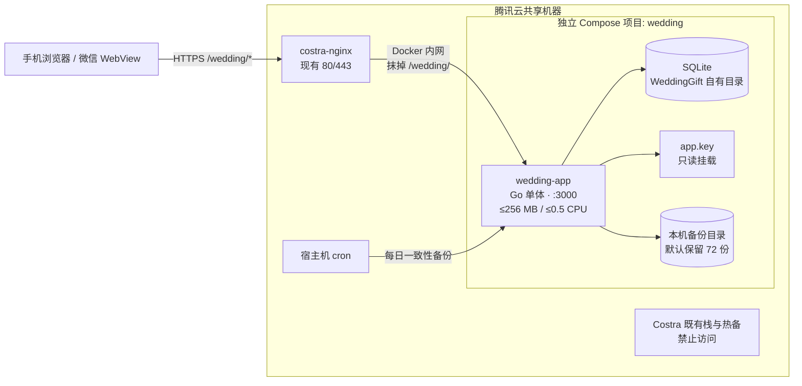
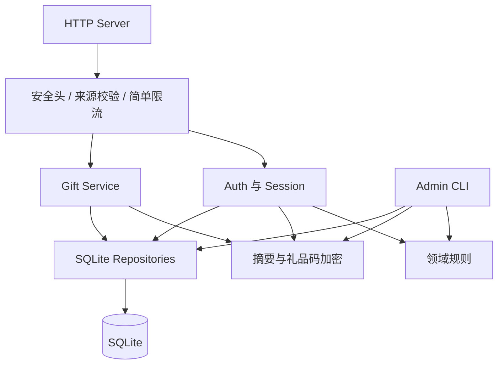
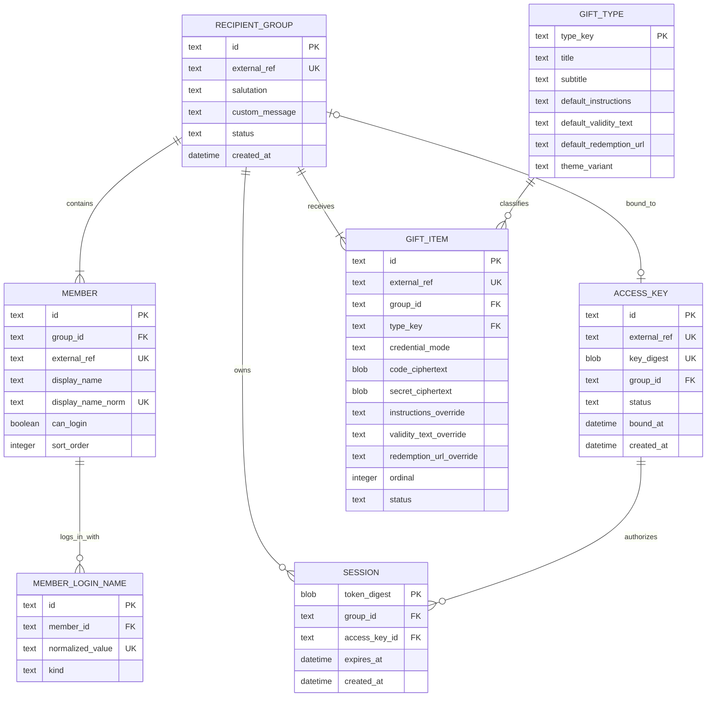
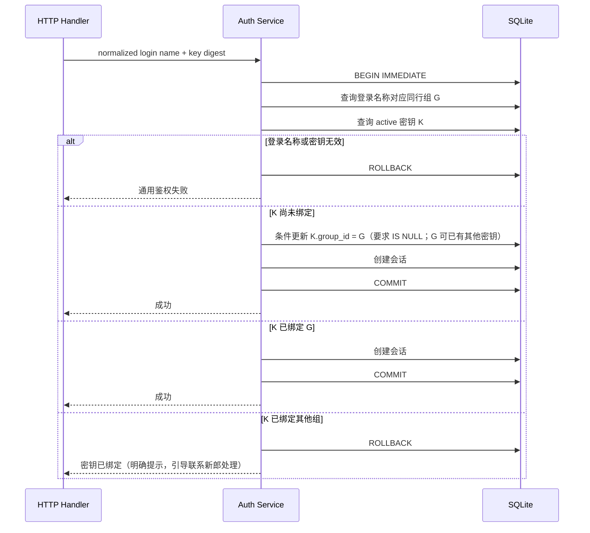
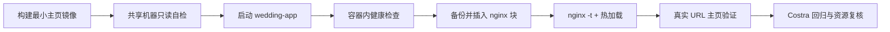

<!--
文档名称: WeddingGift 技术架构设计
文档类型: 技术设计 / 架构决策
版本: v2.11
日期: 2026-09-18
状态: 推荐架构基线，按小规模单机服务原则实施
需求基线: docs/00-project-brief.md
产品设计: docs/01-product-architecture.md
部署约束: staging-machine-brief.md
-->

# WeddingGift 技术架构设计

## 目录

- [1. 架构目标与简化原则](#1-架构目标与简化原则)
- [2. 核心架构决策](#2-核心架构决策)
- [3. 系统拓扑](#3-系统拓扑)
- [4. 技术栈与应用模块](#4-技术栈与应用模块)
- [5. 代码目录蓝图](#5-代码目录蓝图)
- [6. 数据架构](#6-数据架构)
- [7. 登录名称与密钥处理](#7-登录名称与密钥处理)
- [8. 绑定算法](#8-绑定算法)
- [9. HTTP 与前端设计](#9-http-与前端设计)
- [10. 必要安全设计](#10-必要安全设计)
- [11. 数据导入与管理命令](#11-数据导入与管理命令)
- [12. 真实 URL 访问链路](#12-真实-url-访问链路)
- [13. 容器与共享机器部署](#13-容器与共享机器部署)
- [14. 本机备份与轻量运维](#14-本机备份与轻量运维)
- [15. 日志与健康检查](#15-日志与健康检查)
- [16. 测试策略](#16-测试策略)
- [17. 发布、回滚与拆除](#17-发布回滚与拆除)
- [18. 威胁模型与接受风险](#18-威胁模型与接受风险)
- [19. 明确不采用的设计](#19-明确不采用的设计)
- [20. 实施门禁](#20-实施门禁)
- [21. 变更记录](#21-变更记录)

## 1. 架构目标与简化原则

WeddingGift 的技术方案按以下顺序取舍：

1. **核心功能正确**：本名/昵称映射同一成员；一个密钥最多绑定一个同行组，一个同行组可绑定多个密钥；同组可有多份礼品。
2. **先验证真实链路**：在业务功能开发前，让最小主页通过 `https://stg.costra.cloud/wedding/` 可访问。
3. **必要安全**：8 位密钥不可明文入库，礼品码加密保存，日志不记录敏感值，登录有基础限流。
4. **共享机器边界**：不使用、不探测、不挂载 Costra 的数据库、Redis、备份和文件。
5. **保持简单**：单应用、单 SQLite、单实例、本机 cron 备份；低频异常允许人工停服处理。
6. **数据驱动**：同行结构、成员昵称、礼品数量和礼品类型均由配置决定。

本项目没有性能、并发或数据量压力。除保证一次绑定事务的一致性外，不为理论上的高负载、跨机故障或复杂审计建设额外系统。

## 2. 核心架构决策

| 编号 | 决策 | 理由 |
|---|---|---|
| ADR-001 | 使用 Go 单体应用 | 单二进制、运行资源低、部署和命令行工具简单 |
| ADR-002 | 使用 SQLite，且只运行一个应用实例 | 数据量和并发极小；事务和唯一约束足以保证核心绑定规则 |
| ADR-003 | 使用服务端托管的 HTML/CSS/原生 JavaScript | 不引入前端框架和 CDN，保持资源轻量与路径简单 |
| ADR-004 | 同一二进制提供 HTTP 服务和少量管理子命令 | 复用校验和数据访问，不建设公网后台 |
| ADR-005 | 本名和昵称存为独立登录名称记录，统一指向成员 | 自然支持一个成员多个登录入口，避免复制用户 |
| ADR-006 | `access_keys.group_id` 可空、不设唯一约束 | 一行即可表达未绑定或已绑定；「一个密钥最多绑定一个同行组」由绑定事务的条件更新保证；一个同行组可绑定多个密钥（2026-09-13 起放宽，此前为两侧唯一） |
| ADR-007 | 密钥由项目所有者生成，系统只校验、导入和摘要存储 | 满足 8 位数字规则，删除生成器和交付状态机 |
| ADR-008 | 礼品直接归属同行组，一组可有多条礼品记录 | 同一密钥登录后自然得到完整礼品列表 |
| ADR-009 | 一个应用主秘密派生密钥摘要与礼品加密用途 | 保留必要安全，避免多 keyring、轮换和恢复流程 |
| ADR-010 | 使用服务端随机会话，不使用 JWT | 可退出和停用，浏览器不持有业务声明 |
| ADR-011 | 代理抹掉 `/wedding/`，前端只使用相对 URL | 与既定 nginx 接入方式一致，避免根路径错误 |
| ADR-012 | 每小时由宿主机 cron 创建本机 SQLite 一致性备份 | 满足当前风险承受能力，不增加 COS 或异机恢复链路 |
| ADR-013 | 运行日志替代独立审计系统 | 使用人数少且可人工介入，不建设审计表、留存平台或告警系统 |
| ADR-014 | 登录失败只存内存缓冲（上限 100、溢出告警并清 50），日报由 serve 进程内调度发送 | 失败输入情况是非关键运营数据，项目所有者明确接受重启丢失；不落库就不新增表、不动 schema、无保留策略；缓冲在 serve 内存决定了日报调度必须在进程内而非 cron/CLI（2026-09-17 定） |

## 3. 系统拓扑



边界规则：

- 不发布宿主机端口，不使用 host network；
- 不携带 Costra 凭据、连接串或客户端配置；
- 只挂载 `/data/wedding/` 下的自有数据、秘密和备份；
- nginx 只按 `staging-machine-brief.md` 插入 WeddingGift location；
- Costra 已有主从和热备是共享机器事实，与 WeddingGift 数据架构无关。

已知残余风险：

- `wedding-app` 为接受反代必须加入 `costra_default`，与同网 Costra 容器在网络层可达；通过无凭据、无客户端、挂载白名单和最小权限降低误用风险。
- `/wedding/` 与 Costra 其他路径共享同一 HTTPS origin；路径和 Cookie Path 不是强安全隔离。上线前必须复核根作用域 Service Worker、同源可执行内容和 Costra XSS 风险。

## 4. 技术栈与应用模块

### 4.1 技术栈

- Go 当前受支持稳定版本；开始实现时固定精确版本。
- 标准库 `net/http`、`html/template`、`crypto/*`、`database/sql`。
- 轻量纯 Go SQLite 驱动，避免 CGO 与运行镜像系统库耦合。
- 嵌入式 SQL migration；不运行常驻迁移服务。
- 语义化 HTML、原生 CSS、少量原生 JavaScript ES module。
- 静态资源通过 `go:embed` 编译进二进制。
- 结构化 JSON 日志输出到 stdout/stderr，由 Docker 轮转。

### 4.2 应用模块



| 模块 | 职责 |
|---|---|
| HTTP Server | 路由、JSON 编解码、超时、静态资源和统一响应 |
| Middleware | 请求 ID、安全响应头、来源校验、请求体限制、简单限流和会话解析 |
| Auth | 登录名称查询、密钥校验、绑定事务、会话创建和退出 |
| Gift | 返回本组礼品摘要列表，按礼品逐项解密激活码 |
| Domain | 同行组、成员、登录名称、密钥和礼品的不变量 |
| Crypto | 密钥 HMAC、礼品码 AEAD、会话令牌摘要和随机数 |
| Store | 参数化 SQL、migration、短事务和健康查询 |
| Admin CLI | 数据校验/导入、状态、密钥停用和本机备份 |

不再拆分恢复纪元、凭据交付、审计平台、远端备份客户端或复杂密钥轮换模块。

## 5. 代码目录蓝图

```text
WeddingGift/
├── cmd/
│   └── wedding/                 # serve 与 admin 子命令入口
├── internal/
│   ├── app/                     # 生命周期、依赖装配、配置
│   ├── auth/                    # 登录、绑定、会话
│   ├── gift/                    # 多礼品查询与按需显示
│   ├── admin/                   # 校验、导入、状态、停用、备份
│   ├── domain/                  # 实体与不变量
│   ├── cryptox/                 # HMAC、AEAD、随机令牌
│   ├── store/                   # SQLite repository 与事务
│   └── httpx/                   # handler 与 middleware
├── migrations/                  # SQL migration
├── web/
│   ├── index.html
│   └── assets/                  # CSS、JS、小型 SVG
├── testdata/                    # 仅虚构数据
├── deploy/                      # compose 与 WeddingGift nginx 片段
├── ops/                         # 部署、本机备份、回滚、拆除
├── docs/
├── go.mod
├── go.sum
└── Dockerfile
```

规则：

- `internal/domain` 不依赖 HTTP 或 SQLite。
- `testdata` 只包含虚构姓名、昵称、密钥和礼品码。
- `deploy/` 只保存 WeddingGift 自有配置和 nginx 插入片段，不复制 Costra 全量配置。
- `ops/` 只能操作 `/root/WeddingGift`、`/data/wedding`、WeddingGift 容器、`/etc/cron.d/wedding` 单元和说明书允许的 nginx 插入块。
- WeddingGift 全部产出收束到 `/root/WeddingGift/`（代码/部署物）与 `/data/wedding/`（运行时数据），日志走 Docker json-file，不散落其他位置。

## 6. 数据架构

### 6.1 实体关系



### 6.2 关键约束

数据库约束和导入校验共同保证：

1. `MEMBER.display_name_norm` 全局唯一；不为同名设计额外字段或流程。
2. 每位可登录成员至少有一个 `MEMBER_LOGIN_NAME`，其中必须包含本名。
3. `MEMBER_LOGIN_NAME.normalized_value` 全局唯一；本名和所有昵称不能指向不同成员。
4. 每个成员只属于一个同行组，每个启用同行组至少有一名可登录成员。
5. `ACCESS_KEY.key_digest` 全局唯一；明文密钥不入库。
6. `ACCESS_KEY.group_id` 可空、不设唯一约束：一个密钥最多绑定一个同行组（由绑定事务内 `group_id IS NULL` 条件更新保证），一个同行组可绑定多个密钥，同组任一已绑定密钥看到同一份回礼。
7. 每个启用同行组至少一份有效礼品，允许多份；`ordinal` 决定展示顺序。礼品凭证两种形态由实例级 `credential_mode` 自描述：`code` 为单一激活码（`code_ciphertext`），`card_secret` 为卡号+密码（`code_ciphertext` 为卡号、`secret_ciphertext` 为密码；`code` 模式该列为空 BLOB）。激活码/卡号全局唯一，密码不做唯一要求；明文凭据一律 AEAD 密文入库。
8. 礼品类型通过外键引用配置，完全由数据文件驱动（无内置必备清单）；类型提供默认兑换说明、有效期和兑换入口（HTTPS URL 或微信小程序口令），礼品实例可按实际情况覆盖这些字段。
9. 被停用密钥不能创建会话；停用时删除其有效会话。
10. 时间统一以 UTC 存储。

### 6.3 SQLite 设置

保持可理解的最小配置：

```sql
PRAGMA foreign_keys = ON;
PRAGMA journal_mode = WAL;
PRAGMA synchronous = NORMAL;
PRAGMA busy_timeout = 5000;
```

同时：

- 仅运行一个应用实例；连接池保持小规模，例如最多 4 个连接。
- 数据目录权限 `0700`，数据库、秘密和备份文件权限 `0600`；`data`/`backups`/`secrets` 目录及其中文件属主为容器运行用户 65534。
- 所有 SQL 参数化；绑定写事务保持短小，不在事务内做网络或文件操作。
- migration 在发布时由同版本二进制显式执行；失败即停止发布。
- 不设置复杂 page cap、审计容量、自动 vacuum 策略或多版本恢复守卫；本项目数据量可直接人工观察。
- 运行中备份使用 SQLite online backup API，不直接复制活跃的数据库及 WAL 文件。

## 7. 登录名称与密钥处理

### 7.1 登录名称规范化

导入和登录共用一个简单、版本固定的函数：

1. 去除首尾空白；
2. 统一 Unicode NFC；
3. 若未来允许拉丁字母昵称，统一大小写；
4. 不删除姓名内部字符，不做拼音、繁简转换、错别字或近似匹配。

本名和昵称规范化后直接存入 `MEMBER_LOGIN_NAME.normalized_value` 并做唯一索引。姓名数据量极小，且项目所有者已确认本名唯一，因此不引入姓名 HMAC 索引。数据库文件权限、访问边界和日志脱敏承担基础隐私保护。

### 7.2 8 位密钥校验与存储

```text
rawKey 必须匹配 ^[0-9]{8}$
keyDigest = HMAC-SHA256(K_access_lookup, rawKey)
```

- 只接受 ASCII `0`–`9`，不自动删除空格或连字符。
- 8 位数字只有约 26.6 bit 空间，不能使用普通 SHA-256 等可离线穷举摘要。
- `K_access_lookup` 从 `/data/wedding/secrets/app.key` 派生，明文密钥只存在于项目所有者离线源文件和一次导入过程。
- 系统不生成、打印或导出新密钥。

## 8. 绑定算法

### 8.1 原子流程



### 8.2 实现约束

- `BEGIN IMMEDIATE` 与条件更新共同保护「一个密钥最多绑定一个同行组」；同行组侧不设唯一约束（2026-09-13 起一个同行组允许绑定多个密钥）。M4 落地方式：`database/sql` 的 `BeginTx` 对 SQLite 是 DEFERRED 事务，因此 `store.BeginImmediate` 在专用连接上显式执行 `BEGIN IMMEDIATE`/`COMMIT`/`ROLLBACK`，语义与 `sql.Tx` 等价且拿到写锁后才开始读写。
- 首次绑定使用带条件的 `UPDATE`，只允许从 `group_id IS NULL` 变为目标组。
- 访客请求永不修改非空 `group_id`，也不提供解绑接口。
- 同一请求重试不会产生第二条绑定；提交后断网时，使用同组信息重试仍成功。
- 失败响应分两层：登录名称无效或密钥无效/停用统一模糊；密钥已绑定其他同行组返回明确提示（引导联系新郎处理）。
- 虽然没有并发压力，仍保留两个请求争抢同一密钥、以及两个密钥同时绑定同一同行组的集成测试，以验证数据库不变量，而不是建设高并发系统。
- 极少量误绑由项目所有者停服、创建本机备份后人工修正（如停用冒名密钥）；修正后必须重新运行约束和数据完整性检查。

## 9. HTTP 与前端设计

### 9.1 公网路由

nginx 把浏览器的 `/wedding/...` 映射成应用内部 `/...`。

| 方法 | 应用内部路径 | 浏览器实际路径 | 作用 | 鉴权 |
|---|---|---|---|---|
| `GET` | `/` | `/wedding/` | 返回单页主页 | 否 |
| `GET` | `/assets/{file}` | `/wedding/assets/{file}` | 指纹化静态资源 | 否 |
| `GET` | `/api/bootstrap` | `/wedding/api/bootstrap` | 服务状态、当前会话、同行组与礼品摘要 | 可选会话 |
| `POST` | `/api/auth/login` | `/wedding/api/auth/login` | 校验并绑定/登录 | 来源校验 + 限流 |
| `POST` | `/api/auth/logout` | `/wedding/api/auth/logout` | 撤销当前会话并清 Cookie | 会话 |
| `POST` | `/api/gifts/reveal` | `/wedding/api/gifts/reveal` | 按 `giftId` 返回本组某份礼品凭证 | 会话 + 来源校验 |
| `GET` | `/healthz` | `/wedding/healthz` | 进程与 SQLite 只读健康检查 | 通用状态 |

使用 `POST` 揭示礼品凭证，避免预取和普通缓存触发。`giftId` 必须再次校验属于当前会话同行组，不能只信任前端列表。M5 落地：`internal/gift` 负责归属校验与逐份解密；不存在/跨组/已停用统一 `404 + gift_unavailable` 同一响应体，无会话或会话失效 `401 + session_invalid` 并清 Cookie；响应一律 `no-store`（由统一 JSON 写出保证）。响应体统一为 `{code, secret?}`：`code` 模式为激活码（`secret` 省略），`card_secret` 模式 `code` 为卡号、`secret` 为密码；礼品摘要随登录/bootstrap 下发 `credentialMode`，前端据此渲染单码或卡号+密码双行形态。

### 9.2 请求与响应规则

- API 只接受预期方法和 `application/json`；请求体上限 8 KB。nginx 层 `client_max_body_size 2m`（见 `staging-machine-brief.md §6.2`）只是外层粗粒度防护，应用层对 JSON body 另设 8 KB 硬上限，两者是纵深防御而非冲突：nginx 先挡超大异常请求，应用再对合法业务体做严格约束。
- JSON decoder 拒绝未知字段。
- 登录失败统一返回相同状态码、业务码和文案。
- 敏感接口设置 `Cache-Control: no-store`。
- API 不启用 CORS，只接受预期 `Host` 和同源 `Origin`。
- 不向客户端返回 SQL、堆栈、内部 ID 或密钥状态。

### 9.3 前端与路径前缀

- 浏览器只停留在 `/wedding/`，不启用 History API 路由。
- HTML 使用 `assets/app.css`、`assets/app.js` 等相对地址。
- JavaScript 使用 `api/bootstrap`、`api/auth/login` 等相对请求。
- 不发出指向域名根路径的重定向或资源请求。
- 二维码编码精确 URL `https://stg.costra.cloud/wedding/`。
- 多份礼品以纵向卡片列表展示，每份单独揭示和复制。

### 9.4 会话 Cookie

```text
Name: wedding_session
Secure: true
HttpOnly: true
SameSite: Lax
Path: /wedding/  （由 nginx `proxy_cookie_path / /wedding/` 统一收编；应用侧无需再设 Path，若框架强设则设 /wedding/）
```

- Cookie 只保存至少 256 bit 的随机令牌；数据库存令牌 SHA-256 摘要。
- M4 已按本节授权收敛为**固定 30 天有效期**（`auth.SessionTTL`），不做滑动续期：覆盖完整婚礼窗口且实现最简；令牌值以 base64url 编码放入 Cookie。
- 每次读取会话时确认关联密钥仍为 active（同时校验同行组仍为 active）。
- 不使用 `localStorage`、IndexedDB 或 Service Worker 保存会话与礼品码。

## 10. 必要安全设计

### 10.1 单一应用秘密

宿主机保存一个随机 `app.key`（属主容器用户 65534、权限 `0600`，所在 `/data/wedding/secrets` 目录属主 65534、权限 `0700`——容器以非 root 运行，root 属主的 `0700` 目录会阻止其读取），只读挂载给应用。程序使用 HKDF 派生：

- `K_access_lookup`：8 位卡片密钥 HMAC；
- `K_gift_code`：礼品激活码 AEAD 加密。

不建设多 keyring、在线轮换、交付加密或恢复纪元。服务周期短，`app.key` 由项目所有者保留一份离线副本；若秘密丢失，允许人工重建数据。注意：由于密钥以 HMAC 摘要、礼品码以 AEAD 密文存储，`app.key` 一旦丢失，数据库与本机备份中的密钥/礼品码都将无法验证或解密，备份也救不回。因此 `app.key` 的离线副本重要性等同于甚至高于数据库备份，应与真实源数据文件同等级别离线、异位保管。

### 10.2 礼品码与个人信息

- 礼品激活码使用标准 AEAD（如 AES-256-GCM）加密，每条记录使用独立随机 nonce。
- 本名、昵称、同行组称呼为满足直接查询和展示而以明文存在 SQLite 中；依靠文件权限、容器隔离、最小数据范围和到期删除保护。
- 明文姓名、昵称、卡片密钥和礼品码均不写日志。
- 真实数据源文件不进入 Git、镜像或无访问控制的位置。

### 10.3 登录防护

- JSON 内容类型、同源 `Origin`/`Host` 校验共同阻止普通跨站表单提交。M4 落地：`/api` 要求 Host 命中白名单（`WEDDING_ALLOWED_HOSTS`，默认 `stg.costra.cloud`，回环地址总是允许）；非 GET 请求必须携带 `Origin` 且其 host 与请求 Host 一致。
- 使用简单、有界的单实例内存限流：按来源 IP 和失败的密钥摘要限制登录尝试。
- 阈值以不误伤婚礼现场共享 NAT 为前提，M4 落地为单 IP 10 分钟 60 次失败、单密钥 10 分钟 10 次失败（滑动窗口，map 触顶 4096 键时整体清空该维度）。
- 应用重启后限流状态清空可以接受；不引入 Redis 或 CAPTCHA。

### 10.4 响应头和运行权限

至少设置：

```text
Content-Security-Policy: default-src 'self'; script-src 'self'; style-src 'self'; img-src 'self' data:; connect-src 'self'; object-src 'none'; base-uri 'none'; frame-ancestors 'none'; form-action 'self'
X-Content-Type-Options: nosniff
Referrer-Policy: no-referrer
Permissions-Policy: camera=(), microphone=(), geolocation=(), payment=()
X-Frame-Options: DENY
```

容器以非 root 用户运行，root filesystem 只读，drop all capabilities，设置 `no-new-privileges`。TLS 由现有 nginx 负责。

## 11. 数据导入与管理命令

同一 `wedding` 二进制提供以下必要命令：

```text
wedding serve
wedding migrate
wedding healthz-check
wedding data validate --dir <data-dir>
wedding data import --dir <data-dir>
wedding data append --dir <data-dir> [--dry-run]
wedding status
wedding key revoke --ref <card-ref>
wedding gift fix-code --ref <gift-ref>
wedding backup create --output <path>
wedding report daily [--dry-run] [--window 24h]
```

约束：

- `healthz-check` 由 Docker healthcheck 调用：向本地 `serve` 端口发起一次 `/healthz` 请求，成功返回退出码 0、失败非 0；不依赖镜像内的 curl/wget，使镜像可用 distroless/scratch 精简基底。

- `data validate` 校验本名唯一、登录名称全局唯一、每位可登录成员有本名、8 位数字密钥唯一、每组至少一份礼品、礼品类型存在和 HTTPS 链接合法。
- `data import` 在应用停机时执行，先完整校验，再用一个事务写入；任一错误全部回滚。
- `data append` 是上线后的纯追加入口（契约 §2.8）：开放世界校验（库内现状 ∪ 追加包）在事务内复跑后单事务纯 INSERT，任一错误全部回滚；仅新增五类实体（不含密钥），不修改、不删除既有数据；服务在线时可安全执行（WAL + busy_timeout，写事务极短）；`--dry-run` 只校验并输出脱敏核对报告（含引用既有实体清单），零写入。
- 明文密钥和礼品码从权限为 `0600` 的文件或 stdin 读取，不作为命令行参数。
- `status` 只显示内部编号和数量，不显示明文密钥或礼品码。
- `key revoke` 停用密钥并删除其会话，不自动生成替代密钥。
- `gift fix-code` 是「只增不改不删」（契约 §2.8 / D-21）的唯一例外通道：仅当既有 code 模式礼品的激活码明文填错时使用，按 `external_ref` 定位后单事务内「加密 → UPDATE → 读回解密比对」提交，仅重写 `code_ciphertext` 不触碰其他字段；`card_secret` 与不存在的 ref 明确拒绝，空值/含换行值写库前拒绝。新明文从 stdin 读入（同上文「不作命令行参数」纪律），服务在线时可安全执行（单行 UPDATE 短事务；读路径无缓存直读库，提交后下一请求即生效，无需停服）。上机流程见 06 runbook §6.6。
- `report daily` 是**统计口径与 SMTP 链路的人工验证工具**：统计滚动窗口（默认最近 24 小时）内新增的绑定（`access_key.bound_at`）与登录（`session.created_at`）及累积数据（复用 `Stats`），渲染纯统计版日报邮件；`--dry-run` 只打印不发送。统计窗口按 UTC 存储文本直接区间比较（字典序即时间序），展示时区为固定 UTC+8（运行镜像为 scratch 无 tzdata，国内无夏令时，固定偏移即正确）。SMTP 465 端口走 SSL 直连、其他端口走 STARTTLS，认证仅在 TLS 信道上进行；配置经 `WEDDING_SMTP_*` / `WEDDING_MAIL_*` 环境变量注入（见 §14.3）。**正式的每日日报不走 cron/CLI，由 serve 进程内调度发送**（统计 + 登录失败明细，见 §14.3）——登录失败缓冲只存在于 serve 进程内存，独立 CLI 进程不可见，故 CLI 版如实注明不含失败明细。邮件正文含同行组称呼与失败输入名字，不做脱敏——收件人即项目所有者本人（管理员），且邮件不经过应用日志；这不违反 §15.1 的日志脱敏纪律。
- 不提供 `keys generate`、自动补发、自动改绑、凭据交付 spool、恢复或复杂审计命令。
- 极少量特殊修正不产品化为通用功能；唯一的例外是 `gift fix-code`（见上条）——因为激活码密文依赖 app.key 派生密钥，人工 SQL 无法正确构造密文，故收口为这一个窄口子命令，其余特殊修正仍采用停服、先备份、人工 SQL/一次性脚本、完整性检查和重新启动的流程。

## 12. 真实 URL 访问链路

在数据、鉴权和礼品开发前增加独立阶段，只验证访问链路：

1. 构建仅包含主页和 `/healthz` 的最小应用镜像，不包含真实数据和业务秘密。
2. 在共享机器创建 WeddingGift 自有目录并启动容器。
3. 按 `staging-machine-brief.md` 备份并插入 `/wedding/` nginx location。
4. 执行 `nginx -t` 后热加载，禁止重启 Costra nginx。
5. 从外部浏览器和命令行访问 `https://stg.costra.cloud/wedding/`，确认 HTML、CSS/JS 相对路径和 HTTPS 正常。
6. 回归 Costra 原有关键路径、容器状态和资源占用。
7. 保存 nginx 片段和回滚材料；后续版本持续复用同一入口。

该阶段只证明 `浏览器 → HTTPS → costra-nginx → Docker 网络 → wedding-app` 可达，不导入真实姓名、昵称、密钥或礼品码，也不把“主页可访问”等同于业务已上线。

## 13. 容器与共享机器部署

### 13.1 目录边界

WeddingGift 全部产出收束到两处固定根目录，不散落其他位置：`/root/WeddingGift/` 存放代码与部署物，`/data/wedding/` 存放运行时数据；应用日志走 Docker json-file（stdout/stderr），不额外落地散乱日志文件。

| 路径 | 用途 | 规则 |
|---|---|---|
| `/root/WeddingGift/` | compose、镜像版本信息、部署与备份脚本、`/etc/cron.d/wedding` 片段与 nginx 插入片段的仓库副本 | 只属于 WeddingGift |
| `/data/wedding/data/` | SQLite 数据库 | `0700` 目录、数据库 `0600`，属主容器用户 65534 |
| `/data/wedding/backups/` | 本机 cron 备份 | 属主容器用户 65534；默认保留最近 72 份（≈3 天），不写入 Costra 目录 |
| `/data/wedding/secrets/` | `app.key`；`smtp.env`（日报 SMTP 配置，应用运行时主动读取） | `0700` 目录、`0600` 文件，属主容器用户 65534、只读挂载 |
| `/data/wedding/import/` | 首导临时数据包 | root:root `0755` 目录、`0644` 文件（容器 65534 需穿越并读取）；导入后删除或移回离线位置 |
| `/data/wedding/append/` | 追加临时数据包（`data append`） | 同 `import`：root:root `0755` 目录、`0644` 文件、只读挂载；追加后删除或移回离线位置 |
| `/data/wedding/nginx/` | 修改前备份和 WeddingGift 片段 | root:root `0700`，不挂载进容器；不覆盖 Costra 全量配置 |
| `/etc/cron.d/wedding` | WeddingGift 本机备份 cron 单元 | 独立文件；不修改 Costra 的 `costra-standby`/`costra-analyze`；拆除时删除 |

属主与权限约定：`data`、`backups`、`secrets` 及其内容属主为容器运行用户 65534、目录 `0700`——bind mount 保留宿主机属主，容器内非 root 进程必须穿越目录并读写/读取这些文件，root 属主的 `0700` 目录会直接导致访问失败；`/data/wedding` 顶层与 `import`/`append` 为 root:root `0755`——顶层不直接存放文件，但容器 65534 必须能穿越顶层并读取 `import`/`append` 内的 `0644` CSV，若为 `0700` 则 validate/import/append/serve 全链路 EACCES（2026-09-12 上机实测）；`nginx` 为 root:root `0700`，不挂载进容器、仅 root 人工操作。

绝不挂载 `/data/pgsql*`、`/data/redis`、`/data/slave`、`/data/conf/*.env` 或 Docker socket。

### 13.2 Compose 基线

- project name `wedding`，container name `wedding-app`；
- 只 `expose: 3000`，没有 `ports:`；
- external network `costra_default`，不声明自定义 subnet；
- `restart: unless-stopped`；
- 应用内存 hard limit 256 MB、CPU 0.5；
- `json-file` 日志 `max-size: 50m`、`max-file: 3`；
- 非 root、只读 rootfs、`tmpfs /tmp`、`cap_drop: ALL`、`no-new-privileges`；
- 仅数据和备份目录可写，secret 只读；
- 健康检查与合理停止宽限期。

### 13.3 nginx 操作纪律

严格复用 `staging-machine-brief.md §3/§6`：

1. 应用先在 Docker 内网启动并通过健康检查；
2. 备份 live conf 到 `/data/wedding/nginx/`；
3. 只插入 WeddingGift 两个 location；
4. `nginx -t` 成功后热加载，禁止重启或重建 `costra-nginx`；
5. 验证 `/wedding/` 和 Costra 原有关键路径；
6. 每次 `wedding-app` 重建后热加载 nginx，使其重新解析容器地址。

## 14. 本机备份与轻量运维

### 14.1 备份策略

- 宿主机 cron 以**独立单元文件 `/etc/cron.d/wedding`** 落地，不写入或修改 Costra 的 `/etc/cron.d/costra-standby`、`/etc/cron.d/costra-analyze`（见 `staging-machine-brief.md §5.1(3)`）。
- 默认 **每小时 `:44`** 调用 `/root/WeddingGift/ops/backup.sh`；选 `:44` 是为避开整点（00/06/12/18 从库 pg_dump）、`:47`（主从健康检查）、06:27（staging 刷新）和 23:5x（分析窗口）等既有窗口，WeddingGift 备份为秒级 SQLite online backup，不与这些任务实质竞争。执行频率与时间点是脚本与 cron 中的简单配置，可在上线前调整。
- 脚本固定执行 `docker compose -p wedding -f /root/WeddingGift/deploy/compose.yaml exec -T app /app/wedding backup create --output <目标文件>`，让容器内同版本二进制通过 SQLite online backup API 写入 `/data/wedding/backups/wedding-YYYYMMDD-HHMMSS.db`；不得在宿主机额外安装应用二进制。
- 成功后运行 SQLite 完整性检查，并默认只保留最近 **72 份（≈3 天，每小时一份）**；保留数量是脚本中的简单配置。
- 因真实数据在 M6 一次性导入后基本静态，逐小时备份主要覆盖运行期新增的绑定关系与会话意外损坏；真正的事实源仍是项目所有者离线保管的源文件与 `app.key`。
- 发布、migration、真实数据导入和人工修正前可手动额外创建一份备份。
- 备份只写 `/data/wedding/backups/`，不得写入 `/data/slave/backups` 或其他 Costra 目录。

### 14.2 明确接受的限制

- 主数据库和备份在同一台机器，宿主机或磁盘整体损坏时可能同时丢失。
- 不上传 COS，不做主从、跨地域副本、自动故障切换、RPO/RTO、恢复纪元或定期恢复演练。
- 本项目不承诺自动数据恢复；如确有需要，项目所有者根据本地备份和离线源数据人工处理。
- cron 失败只写入本机日志；不建设外部告警平台。项目所有者可在重要时间点人工查看最近备份时间。

### 14.3 每日统计日报与登录失败内存记录（2026-09-17 起）

**日报由 serve 进程内调度发送，不走 cron。** 2026-09-17 第二版起：登录失败明细只保存在 serve 进程内存中，独立进程（cron + CLI）读不到，因此调度必须在进程内——serve 启动一个定时 goroutine，每天北京时间 `07:17`（`WEDDING_REPORT_DAILY_AT`，`HH:MM` 零填充格式）收集滚动 24 小时窗口统计（新增绑定/登录）与累积数据（复用 `Stats`），加上内存缓冲中的全部登录失败明细，渲染纯文本邮件经 SMTP 发送给项目所有者。SMTP 未完整配置时 serve 照常对外服务，仅记 `daily_report_disabled` 警告日志。

日报的绑定情况分两组明细（收件人即管理员，含组称呼，不做脱敏）：**已绑定密钥的同行组**列出该组绑定的密钥编号（`BoundKeyRefs`，一个组可多密钥，已停用组标注）、成员数、active 礼品数与类型；**尚未绑定密钥的同行组**作为待办列出（仅 active 组）。同一口径同时体现在 `status` 命令的组明细列（2026-09-18 起新增「已绑定密钥」列）。

**登录失败内存记录（不持久化）**：所有登录失败分支（输入格式不正确、名字无匹配、密钥无匹配/已停用、密钥已绑定其他同行组）在返回前写入内存环形缓冲，内容为失败类别、用户输入的原始名字、输入密钥的**掩码**（首尾各 2 字符，如 `12****78`，永不保存明文与完整摘要外的信息）及归属注解（名字对应的同行组、输入密钥摘要命中的真实密钥 external_ref 及其已绑组称呼）。缓冲**上限 100 条**：插入第 101 条时立即异步发送「登录失败告警」邮件（含当前全部条目），随后清理最早 50 条，保证最新失败始终可记录。日报**发送成功后才清空缓冲**——每条失败只在一封日报里汇报；发送失败保留到次日重试。**进程重启/崩溃缓冲即清空，项目所有者明确接受该丢失风险**（非关键数据）。

- SMTP 配置（`WEDDING_SMTP_HOST` / `WEDDING_SMTP_PORT` / `WEDDING_SMTP_USER` / `WEDDING_SMTP_PASS` / `WEDDING_MAIL_FROM` / `WEDDING_MAIL_TO`）存于宿主机 `/data/wedding/secrets/smtp.env`（`0600`、属主 65534，与 `app.key` 同目录模型），**由应用运行时主动读取**（随 secrets 只读挂载进容器；真实环境变量优先、文件补缺，`WEDDING_SMTP_ENV_PATH` 可覆盖路径）；**秘密值不进 Git**，仓库只出现文件路径。不经 compose `env_file` 注入——镜像构建机与 compose 执行机都不必持有该文件。容错语义（2026-09-17 修正）：**可选配置问题绝不阻塞站点**——文件缺失即未配置；文件存在但不可读（如属主误为 root 的 `0600`，容器 65534 读不到）或格式/端口非法时，serve 记 `smtp_config_invalid` 警告并禁用日报继续对外服务，`report daily` 发送时才以该错误失败退出（dry-run 仅提示）。
- 邮件正文含同行组称呼与失败输入名字（收件人即项目所有者本人，属管理员自用运营数据）；日报与告警不经应用日志，正文不写 stdout——进程内只记 `daily_report_scheduled` / `daily_report_sent` / `daily_report_failed` / `login_failure_alert_sent` / `login_failure_alert_failed` 事件日志（不含邮件内容）。
- 发送失败只落本机日志，不建设外部告警平台（溢出告警邮件本身即最小告警）；次日日报自然反映最新累积数据。首次启用用 `report daily --dry-run` 核对统计口径、再实发一次验证 SMTP 出网链路（CLI 为纯统计版，见 §11）。
- cron 单元 `/etc/cron.d/wedding` 只保留备份任务（§14.1），不承担日报。

## 15. 日志与健康检查

### 15.1 应用日志

建议字段：

```text
timestamp, level, event, request_id, route, method, status,
duration_ms, internal_group_ref, internal_key_ref, error_class, build_version
```

禁止记录：请求正文、姓名、昵称、明文密钥、礼品码、Cookie、应用秘密和完整 IP。

只记录必要事件：服务启动/停止、登录成功或失败类别、首次绑定、礼品读取失败、数据导入、密钥停用、备份成功/失败、日报调度与发送结果（`daily_report_scheduled` / `daily_report_sent` / `daily_report_failed` / `daily_report_disabled` / `login_failure_alert_sent` / `login_failure_alert_failed`，不含邮件内容）和未处理错误。不创建独立 `AUDIT_EVENT` 表，不设置复杂审计容量与保留状态机。登录失败的输入情况（名字、密钥掩码）只保存在 serve 进程内存缓冲并进入邮件，不写日志、不落库（§14.3、ADR-014）。

### 15.2 健康与人工检查

- Docker healthcheck 调用容器内 `wedding healthz-check`（应用二进制自带子命令，向本地 `/healthz` 发请求并按退出码返回），不依赖镜像内的 curl/wget，兼容 distroless/scratch 精简镜像。
- 健康检查只验证进程、schema 版本和 SQLite 简单只读查询。M4 起 `/healthz` 已接线数据库：Ping 与 schema 版本只读检查失败时返回 503。
- 外部人工检查访问 `/wedding/`，不自动尝试真实登录。
- 发布后执行一次 `docker stats --no-stream`，确认未超过资源上限。
- 日志由 Docker `50m × 3` 自动轮转；不部署 Prometheus、ELK 或新的监控栈。

## 16. 测试策略

| 层级 | 必测内容 |
|---|---|
| 单元测试 | 登录名称规范化、8 位密钥格式、HMAC/AEAD、会话过期、礼品排序、统一错误 |
| 数据校验测试 | 本名唯一、昵称冲突、昵称与他人本名冲突、重复密钥、无礼品组、未知礼品类型 |
| Repository 集成测试 | migration、外键、密钥摘要唯一、事务回滚、密钥停用 |
| 绑定一致性测试 | 正常首绑、同组再登录、同组第二密钥、跨组已绑定拒绝、两个请求争抢同一密钥、两个密钥同时绑定同一组 |
| HTTP 集成测试 | Cookie、Host/Origin、缓存头、安全头、请求体限制、限流和通用错误 |
| E2E | 真实 `/wedding/` 前缀下访问主页、登录、显示多份礼品、复制、退出 |
| 浏览器测试 | iOS Safari、Android Chrome、微信 WebView、剪贴板降级和窄屏 |
| 部署测试 | 最小主页链路、nginx 配置回滚、容器重建后热加载、Costra 原路径回归 |
| 备份测试 | cron 可执行、产生一致性备份、按默认策略保留 72 份、不写入 Costra 目录 |

不要求：50 并发压测、海量数据容量测试、跨机灾难恢复演练、审计上限压力测试或主从切换测试。资源验收只需证明正常使用下不超过 256 MB/0.5 CPU，并且页面在 1 Mbps 链路下可用。

## 17. 发布、回滚与拆除

### 17.1 首次链路发布



### 17.2 后续业务发布

1. 本地使用虚构数据完成自动化与浏览器测试。
2. 创建本机数据库备份和 nginx 配置备份。
3. 导入新镜像，必要时停机执行 migration 或数据导入。
4. 启动应用并做容器内健康检查。
5. 热加载 nginx，使用 canary 数据冒烟。
6. 回归 Costra 原路径并记录镜像版本。

发布避开共享机器既有高峰任务窗口。

### 17.3 回滚

- **无 schema 变化**：切回上一镜像，重建 `wedding-app`，热加载 nginx并冒烟。
- **migration 或数据导入失败**：保持停机，用 `ops/restore-db.sh` 从本机备份恢复（体检、兜底备份、停服替换、migrate 前滚、健康检查与失败自动回滚均由脚本完成），或根据离线数据重新建库（`ops/reset-db.sh` 清库后重新导入）。用备份恢复后可选择清空 `SESSION` 表，强制所有来宾重新登录，避免旧会话状态干扰。
- **nginx 校验失败**：不 reload，恢复修改前备份并重新校验。
- **首次链路失败**：删除 WeddingGift location，`nginx -t` 后热加载；Costra 其余配置不动。

### 17.4 到期拆除

1. 关闭新登录并显示到期说明。
2. 确认服务数据可以按既定到期策略删除；本方案不安排拆除期跨机器归档。
3. 按 `staging-machine-brief.md §7` 删除 WeddingGift location 并热加载。
4. 删除 WeddingGift cron 单元 `/etc/cron.d/wedding`（不动 Costra 的 cron 文件）。
5. 停止并删除 `wedding` compose 项目及自有镜像。
6. 删除 `/root/WeddingGift/` 和 `/data/wedding/`。
7. 验证 `/wedding/` 返回既定 404，Costra 原路径健康，Docker 网络未被修改。

## 18. 威胁模型与接受风险

| 威胁或问题 | 处理方式 |
|---|---|
| 猜测姓名和 8 位密钥 | 密钥 HMAC 存储、统一错误、简单 IP/密钥限流、服务不公开引流 |
| 一个密钥尝试其他组 | 数据库中的唯一绑定和事务比较 |
| 第二个密钥尝试同一组 | 产品决策允许（同组多密钥）；一个密钥尝试绑定多个组由条件更新与事务拒绝 |
| 管理误操作 | 导入前校验、停机操作、本机备份；少量异常人工复核 |
| 数据库文件被复制 | 礼品码 AEAD、卡片密钥 HMAC；姓名明文泄漏风险由文件权限和小范围使用接受 |
| WeddingGift XSS | 无第三方脚本、CSP、模板转义、`textContent`、输入长度限制 |
| 同源 Costra 脚本风险 | 上线前复核；路径不能形成强隔离，无法接受时改用独立 origin |
| 容器经共享网络误连 Costra | 无凭据、无客户端、无地址配置、挂载白名单和部署复核 |
| 日志泄漏 | 字段白名单、禁止正文/Cookie/姓名/密钥/礼品码、Docker 轮转 |
| 整机或磁盘损坏 | 明确接受本机数据库和备份可能同时丢失；必要时用离线事实源人工重建 |
| nginx 块被覆盖 | 保存片段与配置备份，发现 404 后按说明重新插入并热加载 |
| 首次故意输入他人姓名 | 业务明确接受；低频误绑由项目所有者人工处理 |

## 19. 明确不采用的设计

为防止后续重新引入不必要复杂度，以下内容不属于 WeddingGift 首版：

- PostgreSQL、Redis、消息队列、缓存层、搜索服务；
- 主从数据库、读写分离、多实例、负载均衡或自动故障切换；
- COS、跨地域副本、备份新鲜度 API、RPO/RTO 或自动灾难恢复；
- 恢复纪元、恢复 sentinel、历史密钥隔离状态机；
- 系统密钥生成器、凭据交付 spool、delivery ack、自动补发和复杂幂等工作流；
- 独立审计表、审计容量上限、长期审计归档或外部告警平台；
- 多 keyring 在线轮换和离线索引重建框架；
- 高并发压测、海量数据边界和复杂容量治理；
- 公网管理后台、CI/CD 平台或新的监控栈。

只有当实际业务规模或风险条件发生明确变化时，才重新评估这些能力；不得以“以后可能需要”为由提前建设。

## 20. 实施门禁

### 20.1 开始编码前

- [ ] 接受 Go 单体 + SQLite + 原生前端；
- [ ] 数据契约包含成员、多登录名称、卡片密钥（一组可多密钥）和多礼品；
- [ ] 密钥严格为项目所有者生成的 8 位 ASCII 数字；
- [ ] 接受本机 cron 备份及整机故障可能丢失数据的风险；
- [ ] 明确接受或重新决策同网可达与同源风险。

### 20.2 最小主页链路门禁

- [ ] 最小镜像不含真实数据和业务秘密；
- [ ] `https://stg.costra.cloud/wedding/`、静态资源和 `/wedding/healthz` 可访问；
- [ ] nginx 只修改允许的 WeddingGift 块且可回滚；
- [ ] Costra 原路径、容器与资源状态不受影响。

### 20.3 真实数据开放前

- [ ] 本名、昵称、组、8 位密钥和多礼品数据通过完整校验；
- [ ] 三种首批礼品类型已配置，新增类型不依赖鉴权改动；
- [ ] 绑定（含同组多密钥）、会话、礼品隔离、限流和目标浏览器 E2E 通过；
- [ ] 本机 cron 备份已产生并成功轮转；
- [ ] canary 冒烟、回滚材料和 Costra 回归通过。

## 21. 变更记录

| 版本 | 日期 | 变更内容 |
|---|---|---|
| v2.12 | 2026-09-27 | 新增 `gift fix-code` 上线后纠错通道（§11）：code 模式礼品激活码填错时按 external_ref 单事务修正（加密 → UPDATE → 读回解密比对），明文走 stdin，在线零停机；为「只增不改不删」（D-21）唯一例外，上机流程见 06 runbook §6.6 |
| v2.11 | 2026-09-18 | 日报补齐已绑定同行组明细（§14.3）：`GroupStat.BoundKeyRefs` 给出该组已绑定密钥编号（字典序），日报新增「已绑定密钥的同行组」小节（含停用标注），原未绑定小节改为待办语义；`status` 组明细同步新增「已绑定密钥」列 |
| v2.10 | 2026-09-17 | SMTP 配置容错修正（§14.3）：文件不可读/格式非法不再导致进程退出——`LoadConfig` 连同完整可用配置返回错误，serve 记 `smtp_config_invalid` 警告并禁用日报继续服务，`report daily` 发送时失败退出、dry-run 仅提示；起因是上机 `0600 root:root` 的 smtp.env 使容器 65534 读出 EACCES、serve 无法启动（即时修复：文件 `chown 65534:65534`） |
| v2.9 | 2026-09-17 | SMTP 配置加载改为应用运行时主动读取：移除 compose `env_file`（镜像构建机/compose 执行机不再要求持有 smtp.env），环境变量优先、`/data/wedding/secrets/smtp.env` 文件补缺（`WEDDING_SMTP_ENV_PATH` 可覆盖），文件缺失仅日报不启用、格式非法启动报错；`deploy-app.sh` 前置报错降级为提示；§13.1/§14.3 同步 |
| v2.8 | 2026-09-17 | 日报架构改为 serve 进程内调度（ADR-014、§14.3）：新增登录失败内存记录（上限 100、溢出即告警邮件并清最早 50、密钥只存掩码、归属注解富化），日报含全部失败明细且发送成功才清空缓冲；日报不再走 cron（`ops/daily-report.sh` 撤除，cron 单元回归只保留备份），CLI `report daily` 重新定位为统计口径与 SMTP 链路的人工验证工具（纯统计版）；`store.LoginDenyGeneric` 拆分为名称/密钥两类内部原因（对外仍统一模糊），新增 `WEDDING_REPORT_DAILY_AT`（默认 `07:17`）；零 schema 变更不变 |
| v2.7 | 2026-09-17 | 新增每日统计日报（§11 `report daily`、§14.3）：滚动 24 小时窗口统计新增绑定/登录 + 累积数据（复用 `Stats`，零 schema 变更），经 SMTP（465 SSL / STARTTLS）发送纯文本邮件给项目所有者，含未绑定同行组称呼明细（收件人即管理员，不做脱敏）；SMTP 配置走 `/data/wedding/secrets/smtp.env` + compose `env_file`（不进 Git）；上机流程见 06 runbook §6.5 |
| v2.6 | 2026-09-15 | 新增 `data append` 上线后纯追加入口（§11）：开放世界校验（库内现状 ∪ 追加包）+ 单事务纯 INSERT，仅新增五类实体（不含密钥）、不修改不删除既有数据，服务在线可执行；追加数据包走专用目录 `/data/wedding/append`（与首导 `import` 语义分离，§13.1 表同步）；契约侧见 04 文档 §2.8，上机流程见 06 runbook §6.4 |
| v2.5 | 2026-09-14 | 礼品类型契约修订（数据约束第 8 条）：取消首批内置必备清单硬校验，旅游年卡细化为地区变体；兑换入口由仅 HTTPS 放宽为 HTTPS URL 或微信小程序口令（`#小程序://名称/路径`），与 `docs/04-m0-decisions.md` v1.2 同步 |
| v2.4 | 2026-09-14 | 移除 `ops/test.sh`、`ops/verify-public.sh`、`ops/canary-smoke.sh`、`ops/staging-selfcheck.sh`：§16 各层测试改用显式命令（`go test -race ./...` 等，见 README），前端危险 API / 外部资源 / 持久存储与秘密按代码约定人工 + CR 把关；发布验证与 canary 冒烟改由 `docs/06-m6-runbook.md` §4 的人工核对清单覆盖；`docs/05-m2-runbook.md` §2/§4 与 `docs/06-m6-security-review.md` 同步 |
| v2.3 | 2026-09-13 | 绑定约束放宽：0001 schema 直接移除 `access_key.group_id` 唯一约束（测试阶段直接重置数据库，不做版本兼容），ADR-006 同步修订；「密钥已绑定其他同行组」从统一模糊失败改为明确提示可联系新郎处理；登录页文案与页签标题调整 |
| v2.3 | 2026-09-15 | 礼品凭证双形态：`GIFT_ITEM` 新增 `credential_mode`（`code`/`card_secret`）与 `secret_ciphertext` 列；reveal 响应统一 `{code, secret?}`，摘要下发 `credentialMode`；§6.1/§6.2/§9.1 同步，契约侧见 04 文档 D-15 修订与 §2.6 |
| v2.2 | 2026-09-12 | §13.1 目录权限修正：`/data/wedding` 顶层与 `import` 为 root:root `0755`（原 `0700` 阻止容器 65534 穿越，上机 `data validate` 实测 permission denied），`nginx` 明确 root:root `0700` 不挂载进容器；与 `ops/deploy-app.sh` 同步 |
| v2.1 | 2026-09-12 | 新增数据维护脚本：`ops/reset-db.sh`（清库重置）与 `ops/restore-db.sh`（备份还原，失败自动回滚）；§17.3 回滚改走脚本 |
| v2.0 | 2026-09-12 | 仓库根目录由 `/opt/wedding` 更正为 `/root/WeddingGift`（staging 实际 git clone 位置），§5/§13.1/§14.1/§17.4 全部引用同步更新 |
| v1.9 | 2026-09-12 | M6 本地部分落地：§16 测试策略收口为 `ops/test.sh` 一条命令（WG-601，含 `internal/httpx/security_test.go` 安全回归与来宾旅程 E2E）；WG-602 安全与共享边界核对完成（`docs/06-m6-security-review.md`，含 2026-09-12 同源/根 Service Worker 公网实证）；compose 落地 `/data/wedding/import` 只读挂载（§13.1 表既有目录的挂载补齐，供 WG-603 真实数据导入）；WG-603/604 上机手册 `docs/06-m6-runbook.md` 与 `ops/canary-smoke.sh` 就位 |
| v1.8 | 2026-09-12 | M5 落地：`POST /api/gifts/reveal` 与 `internal/gift` 就位（归属校验 + 按需解密，跨组/未知统一 404）；文案字段补齐 `maintenance_text`（`WEDDING_MAINTENANCE_TEXT`）；前端单页应用按 §9.3 与产品 §10 实现（视觉令牌、登录/多礼品/异常态状态机、剪贴板降级、textContent 渲染），替代 M1 占位主页 |
| v1.7 | 2026-09-12 | M4 落地：§8.2 明确 BEGIN IMMEDIATE 经专用连接显式事务实现；§9.4 会话收敛为固定 30 天有效期；§10.3 落地 Host 白名单 + Origin 同源校验与限流默认阈值；§15.2 healthz 接线 SQLite 只读检查；`bootstrap`/`login`/`logout` API 就位（礼品码 reveal 属 M5） |
| v1.6 | 2026-09-12 | M3 落地：纯 Go 驱动 modernc.org/sqlite（经 `sql.Conn.Raw` 使用 SQLite online backup API）；§14.1 备份命令的 compose 路径修正为仓库实际布局 `/opt/wedding/deploy/compose.yaml` |
| v1.5 | 2026-09-12 | 修正 secrets 目录属主缺陷：`/data/wedding/secrets` 及 `app.key` 属主为容器用户 65534（root:root `0700` 目录会阻止非 root 容器进程读取，M3 起必现）；§10.1/§13.1 补属主约定，同步 `ops/deploy-app.sh` 与 M2 手册 |
| v1.4 | 2026-09-11 | 备份改为每小时 `:44` 触发、保留 72 份，明确宿主机 cron 以独立 `/etc/cron.d/wedding` 落地并写入避峰推导；补 `wedding healthz-check` 子命令供 distroless 健康检查；写清 nginx 2m 与应用 8KB 请求体为纵深防御；Cookie Path 统一 `/wedding/`；强调 `app.key` 离线保管重要性；恢复后可清空 SESSION；目录收束到 `/opt/wedding` 与 `/data/wedding` 并同步拆除清单 |
| v1.3 | 2026-09-11 | 数据模型改为成员多登录名称、密钥与同行组一对一及同行组多礼品；密钥固定人工生成的 8 位数字；新增真实 URL 最小主页阶段；删除 COS、主从、恢复纪元、复杂交付、重审计和高并发容量设计 |
| v1.2 | 2026-09-11 | 完成原始技术架构基线 |
