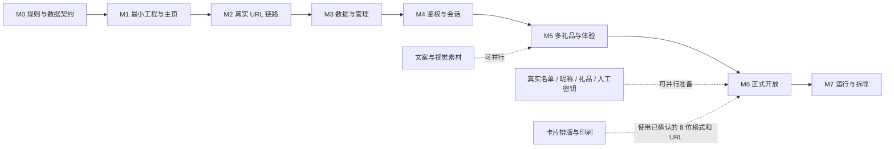

<!--
文档名称: WeddingGift 开发任务拆分与交付计划
文档类型: 开发计划 / 工作分解结构
版本: v1.5
日期: 2026-09-12
状态: 设计已按最新规则收敛，待完成 M0 后开始开发
依赖文档: docs/00-project-brief.md, docs/01-product-architecture.md, docs/02-technical-architecture.md, staging-machine-brief.md
-->

# WeddingGift 开发任务拆分与交付计划

## 目录

- [1. 计划目标](#1-计划目标)
- [2. 实施原则](#2-实施原则)
- [3. 里程碑总览](#3-里程碑总览)
- [4. 任务依赖关系](#4-任务依赖关系)
- [5. 详细任务拆分](#5-详细任务拆分)
- [6. 数据准备工作流](#6-数据准备工作流)
- [7. 测试矩阵](#7-测试矩阵)
- [8. 发布与上线计划](#8-发布与上线计划)
- [9. 风险与应对](#9-风险与应对)
- [10. 工期建议](#10-工期建议)
- [11. 全局完成定义](#11-全局完成定义)
- [12. 下一步入口](#12-下一步入口)
- [13. 变更记录](#13-变更记录)

## 1. 计划目标

把产品与技术架构拆成可以逐项交付、独立验收、失败可回退的开发任务。开发顺序优先确认真实 URL 访问链路，再完成数据、鉴权和礼品体验，避免业务功能完成后才发现 nginx、Docker 网络或路径前缀不通。

当前状态：**仅完成设计文档，尚未创建代码、依赖、容器、数据库或服务器配置。**

## 2. 实施原则

1. 先用最小占位主页打通 `https://stg.costra.cloud/wedding/`，再开发完整业务。
2. 真实 URL 链路阶段不包含真实姓名、昵称、密钥或礼品码。
3. 后续开发先使用全量虚构数据，真实数据只在正式开放前导入。
4. 本名和多个昵称必须映射到同一成员，不复制用户记录。
5. 密钥只接受项目所有者生成的 8 位纯数字；系统不生成密钥。
6. 密钥与同行组严格一对一；同行组支持一到多份礼品。
7. 只保留核心功能需要的安全和事务约束，不建设 COS、主从、高可用、复杂恢复、重审计或高并发能力。
8. 共享服务器只运行本地已验证、已限制资源的镜像；任何 nginx 操作严格遵守 `staging-machine-brief.md`。
9. 真实数据、应用秘密和明文密钥/礼品码永不进入 Git。

## 3. 里程碑总览

| 里程碑 | 目标 | 主要交付物 | 退出门禁 | 参考工作量 |
|---|---|---|---|---:|
| M0 需求与数据契约冻结 | 把最新业务规则落到字段和验收条件 | 决策记录、数据模板、虚构样例 | G0：规则与字段无歧义 | 0.5–1 人日 |
| M1 最小工程与主页 | 建立可构建、可容器运行的最小服务 | Go 工程、占位主页、健康检查、容器基线 | G1：本地主页与容器可用 | 1–2 人日 |
| M2 真实 URL 访问链路 | 优先验证公网到应用的完整链路 | `/wedding/` 可访问、nginx 备份、回滚记录、Costra 回归 | G2：真实 URL 和共享机均健康 | 0.5–1 人日 |
| M3 数据与管理能力 | 建立精简数据模型和导入工具 | SQLite、加密、校验/导入、状态、停用、本机备份 | G3：虚构数据完整闭环 | 2–3 人日 |
| M4 鉴权与会话 | 完成本名/昵称和一对一绑定闭环 | 登录、绑定、会话、来源校验、限流 | G4：鉴权决策全部通过 | 2–3 人日 |
| M5 多礼品与来宾体验 | 完成移动端完整流程 | 致谢、多礼品显示/复制、错误态、备案与隐私 | G5：目标浏览器 E2E 通过 | 2–3 人日 |
| M6 质量收口与正式开放 | 导入真实数据并完成上线检查 | 自动化、真实数据、cron、canary、发布与回滚记录 | G6：核心功能和 Costra 回归通过 | 2–3 人日 |
| M7 运行与到期拆除 | 小范围人工维护并干净退出 | 巡检、人工异常处理、最终备份和拆除记录 | 按生命周期执行 | 按需 |

单人完成 M0–M6 建议按 **10–15 人日** 规划，不包含真实名单与礼品整理、文案确认、实体卡印刷等待和婚礼日期缓冲。该估算已经删除异机灾备、复杂凭据交付、重审计和高并发验证工作。

## 4. 任务依赖关系

关键路径为 `M0 → M1 → M2 → M3 → M4 → M5 → M6`。M2 只验证占位主页链路；真实数据仍留在线下，直到 M6 才进入服务器。

## 5. 详细任务拆分

### M0：需求与数据契约冻结

#### WG-001 冻结业务决策

- **内容**：确认姓名唯一、本名与多昵称归并、8 位数字密钥、密钥与同行组一对一、多礼品、三种首批礼品类型、本机 cron 备份和人工异常处理边界。
- **交付物**：更新后的需求基线和决策清单。
- **完成标准**：不存在会改变数据库关系、密钥格式或礼品展示结构的未决问题。

#### WG-002 冻结数据契约

- **内容**：确定同行组、成员、登录名称、礼品类型、礼品实例和卡片密钥六类数据字段；准备虚构样例。
- **交付物**：字段说明、UTF-8 CSV/JSON 模板、虚构数据包。
- **完成标准**：样例覆盖单身、夫妻、带娃、一个成员多个昵称、三个礼品类型、一个组多份礼品及一对一密钥约束；不包含同名场景。

#### WG-003 定义文案字段与占位内容

- **内容**：确定新人称呼、婚礼日期、全局感谢语、隐私短文案、联系提示、备案展示和礼品兑换说明的配置字段；为最小主页准备虚构占位内容。
- **交付物**：文案字段清单和占位文本。
- **完成标准**：M1/M2 不依赖最终文案即可实现和验证；真实文案可在 M3–M4 期间并行确认，且不需要硬编码进组件逻辑。

**G0 门禁**：WG-001～002 完成，WG-003 的字段和占位文本完成；最终文案不阻塞 M1/M2；真实敏感数据仍未进入仓库；同网和同源残余风险已知。

### M1：最小工程与主页

#### WG-101 建立工程基线

- **内容**：初始化 Go module、目录、格式化/静态检查/测试命令、版本信息和构建入口。
- **交付物**：可重复构建的最小二进制。
- **完成标准**：干净环境可构建，依赖锁定，无真实数据。

#### WG-102 实现占位主页与健康检查

- **内容**：实现 `GET /`、最小 HTML/CSS、相对静态资源和 `GET /healthz`；实现 `wedding healthz-check` 子命令供 Docker healthcheck 调用（不依赖镜像内 curl/wget，兼容 distroless/scratch）；页面明确为 WeddingGift 链路验证页。
- **交付物**：不依赖数据库和业务秘密的占位主页。
- **完成标准**：本地访问正常；页面和资源无域名根路径依赖。

#### WG-103 建立容器基线

- **内容**：多阶段构建、非 root、只读 rootfs、健康检查、资源和日志限制、external network 配置。
- **交付物**：本地 compose 和最小镜像。
- **完成标准**：无 `ports:`、privileged、host network、docker.sock 或 Costra 数据挂载；应用限制为 256 MB/0.5 CPU。

**G1 门禁**：最小二进制、占位主页、静态资源、健康检查和容器在本地全部可用。

### M2：真实 URL 访问链路

#### WG-201 执行共享机器只读自检

- **内容**：执行 `staging-machine-brief.md §8`，记录 CPU、内存、磁盘、容器、网络、cron 和 nginx 现状。
- **交付物**：带时间的自检记录。
- **完成标准**：资源余量满足要求，`costra_default` 和 nginx 文件存在，无冲突 WeddingGift 块。

#### WG-202 部署最小主页容器

- **内容**：创建 WeddingGift 自有目录，加载最小镜像并启动容器；此时不创建真实数据库、不挂载真实导入文件。
- **交付物**：Docker 内网可访问的 `wedding-app`。
- **完成标准**：容器健康，资源与挂载符合红线，Costra 容器未被修改。

#### WG-203 接入 nginx 并验证真实 URL

- **内容**：备份 live conf，只插入 WeddingGift location，执行 `nginx -t` 和热加载；从公网访问主页和静态资源。
- **交付物**：可访问的 `https://stg.costra.cloud/wedding/`、nginx 片段副本和回滚记录。
- **完成标准**：主页、静态资源和 `/wedding/healthz` 正常；无根路径 404；Costra 原有关键路径、容器和资源状态不变。

**G2 门禁**：真实 URL 访问链路已打通，回滚步骤实测可用，页面不含任何真实业务数据。

### M3：数据、加密与管理能力

#### WG-301 实现 SQLite schema 与约束

- **内容**：同行组、成员、登录名称、卡片密钥、礼品类型、礼品实例和会话表；外键与唯一索引。
- **交付物**：migration、repository 和集成测试。
- **完成标准**：本名唯一；登录名称全局唯一；一个成员只属一组；密钥与同行组两侧最多一个；每组支持多份礼品。

#### WG-302 实现最小加密边界

- **内容**：读取单一 `app.key`，用 HKDF 派生密钥 HMAC 和礼品码 AEAD 用途；实现会话随机令牌及摘要。
- **交付物**：crypto service 和测试向量。
- **完成标准**：数据库无明文卡片密钥和礼品码；错误秘密安全失败；不引入 keyring 和轮换框架。

#### WG-303 实现数据预检与导入

- **内容**：解析数据文件，校验 Unicode、字段长度、本名唯一、登录名称冲突、8 位 ASCII 数字密钥、重复密钥/礼品码、组内礼品数量、类型引用、类型默认兑换信息、实例级可选覆盖和 HTTPS 链接。
- **交付物**：`data validate`、`data import` 和脱敏数量报告。
- **完成标准**：先完整校验后单事务写入；任一错误数据库零写入；系统不生成密钥。

#### WG-304 实现状态与密钥停用

- **内容**：输出组/成员/登录名称/礼品/密钥数量及绑定状态；停用指定密钥并删除其会话。
- **交付物**：`status`、`key revoke`。
- **完成标准**：报告不含明文密钥和礼品码；不提供自动补发或改绑。

#### WG-305 实现本机备份命令与 cron 脚本

- **内容**：使用 SQLite online backup API 生成一致性备份，运行完整性检查，默认按最近 72 份（≈3 天、每小时一份）轮转；提供宿主机 cron 安装说明，cron 以独立单元 `/etc/cron.d/wedding` 落地（不写 Costra cron 文件），默认每小时 `:44` 触发，并固定由 `docker compose ... exec -T app /app/wedding backup create` 调用容器内同版本二进制。
- **交付物**：`backup create`、`ops/backup.sh`、`/etc/cron.d/wedding` cron 样例（含避峰说明）。
- **完成标准**：备份只写 `/data/wedding/backups/`；cron 用独立文件不改 Costra；宿主机不额外安装应用二进制；不访问 COS、`/data/slave/backups` 或其他 Costra 路径。

**G3 门禁**：虚构数据完成“校验 → 导入 → 状态 → 本机备份”闭环，数据库约束正确，扫描不到明文密钥和礼品码。

### M4：鉴权、绑定与会话

#### WG-401 实现登录名称查询

- **内容**：统一本名和昵称规范化；从登录名称找到唯一成员及同行组。
- **交付物**：登录名称解析服务。
- **完成标准**：同一成员的本名和多个昵称得到相同成员 ID；冲突名称无法导入。

#### WG-402 实现 8 位密钥查询

- **内容**：严格 `^[0-9]{8}$` 校验，使用 HMAC 摘要查询；前后端不自动移除分隔符。
- **交付物**：密钥解析和查询服务。
- **完成标准**：全角数字、空格、字母、少于或多于 8 位均拒绝；日志无原文。

#### WG-403 实现一对一绑定事务

- **内容**：`BEGIN IMMEDIATE`、条件更新、`group_id` 唯一约束、同组成功/跨组失败/组已有其他密钥失败和断网重试。
- **交付物**：Auth Service 核心用例。
- **完成标准**：一个密钥最多一个组，一个组最多一个密钥；两个冲突请求最多一个成功。

#### WG-404 实现服务端会话

- **内容**：随机 token、摘要入库、Secure/HttpOnly/SameSite Cookie、过期、退出和密钥停用后的失效。
- **交付物**：Session Service 与 middleware。
- **完成标准**：Cookie 限定 `/wedding/`；不在浏览器持久存储礼品码或业务身份。

#### WG-405 实现来源校验、简单限流和登录 API

- **内容**：Host/Origin、JSON content type、请求体上限、按 IP/密钥摘要的有界内存限流、统一错误、请求 ID 和缓存头。
- **交付物**：`bootstrap`、`login`、`logout` API。
- **完成标准**：外部无法从状态码或文案区分“名字错/密钥错/跨组/组已有密钥”；共享 NAT 下正常使用不过度误伤。

**G4 门禁**：本名、多昵称、首绑、同组共享、跨组拒绝、同行组第二密钥拒绝、会话、退出、停用和基础限流全部通过。

### M5：多礼品与来宾体验

#### WG-501 实现多礼品服务

- **内容**：返回本组礼品摘要列表；按 `giftId` 校验归属并逐份解密礼品码；响应禁止缓存。
- **交付物**：Gift Service、礼品摘要和 `POST /api/gifts/reveal`。
- **完成标准**：一组一到多份礼品均可展示；不能读取其他组礼品；明文不进入 URL、日志或浏览器持久存储。

#### WG-502 建立视觉系统与响应式页面

- **内容**：暖象牙/灰粉/香槟金视觉令牌、单列卡片、轻量 SVG/CSS、手机/桌面适配和减少动画。
- **交付物**：登录与礼品页面视觉壳。
- **完成标准**：不依赖图片、视频、外部字体；关键文本对比度和 44 px 触控目标达标。

#### WG-503 完成登录交互

- **内容**：“名字或昵称”字段、8 位数字密钥输入、提交防重复、加载态、通用失败、限流和网络恢复。
- **交付物**：从二维码落地到成功欢迎的完整流程。
- **完成标准**：输入格式清楚；后端内部错误不暴露给用户。

#### WG-504 完成同行组欢迎与多礼品交互

- **内容**：同行组称呼、专属短句、安全文本渲染、多礼品列表、逐份遮罩/显示/复制/隐藏、退出和剪贴板降级。
- **交付物**：完整成功页。
- **完成标准**：旅游年卡、电影券、咖啡券可同时出现；刷新或退出后全部重新遮罩；同组成员看到相同列表。

#### WG-505 完成合规与异常状态

- **内容**：隐私短说明、备案链接、联系提示、维护/到期状态、礼品配置异常和服务错误编号。
- **交付物**：所有非成功状态。
- **完成标准**：无死路、无敏感错误细节、无根路径链接。

**G5 门禁**：主流程在目标 iOS Safari、Android Chrome 和微信 WebView 上通过；三类和多份礼品场景通过。

### M6：质量收口与正式开放

#### WG-601 完成核心自动化回归

- **内容**：单元、数据校验、repository、绑定一致性、HTTP 和 E2E 测试。
- **交付物**：一条命令可运行的测试集合。
- **完成标准**：核心业务分支全覆盖；不依赖真实数据或测试顺序。

#### WG-602 完成安全与共享边界核对

- **内容**：SQL 注入、XSS、来源校验、枚举差异、会话撤销、缓存、日志泄密、秘密扫描；复核 Costra 根 Service Worker、同源可执行内容和共享网络边界。
- **交付物**：简洁安全清单和残余风险确认。
- **完成标准**：未接受的核心安全问题为零；不扩展为通用安全审计项目。

#### WG-603 导入真实数据并启用 cron

- **内容**：停机执行真实数据 dry-run 和导入；核对本名/昵称、组、人工密钥和多礼品数量；创建 canary；安装默认每小时 `:44` 执行、可在上线前调整的本机备份 cron（独立 `/etc/cron.d/wedding`，不改 Costra cron）。
- **交付物**：真实数据库、脱敏核对报告、canary、本机备份和 cron 记录。
- **完成标准**：明文源文件已移出服务器导入目录；备份写入自有目录并轮转；不配置 COS 或主从。

#### WG-604 发布正式版本并冒烟

- **内容**：备份数据库和 nginx 配置，发布镜像，执行 canary 首绑/同组登录/跨组失败/第二密钥拒绝/多礼品显示/复制/退出，复核 TLS、响应头、资源和日志。
- **交付物**：上线检查表、镜像版本和回滚点。
- **完成标准**：真实 URL 完整流程通过；Costra 原路径、容器和资源状态不变；回滚材料可用。

**G6 门禁**：产品验收用例、目标浏览器、cron、本机备份、canary 和 Costra 回归全部通过，才通知真实来宾使用。

### M7：运行支持与拆除

#### WG-701 日常人工巡检与支持

- 在重要日期前查看 `/wedding/`、容器健康、磁盘、最近本机备份和 5xx 日志。
- 使用 `status` 和 `key revoke` 处理常规问题；误绑或数据错误停服后人工修正。
- Costra nginx 相关变更后验证 WeddingGift 块仍存在。
- 不在运行中随意打开 SQLite 修改。

#### WG-702 服务关闭与数据清理

- 到期前确认是否延长，否则进入关闭状态。
- 确认服务数据可以按既定到期策略删除；不安排拆除期跨机器归档。
- 按 `staging-machine-brief.md §7` 删除 location、容器和自有目录。
- 验证 Costra 配置恢复且共享机器无 WeddingGift 残留。

## 6. 数据准备工作流

### 6.1 环境与数据隔离

| 环境 | 数据 | 允许用途 |
|---|---|---|
| 单元/集成测试 | 程序生成的虚构数据 | 自动化测试，可提交 Git |
| 本地 E2E | 覆盖业务边界的虚构完整数据包 | UI、浏览器和反代测试 |
| M2 真实 URL 占位页 | 无业务数据 | 只验证访问链路 |
| 共享机器 canary | 独立虚构组、昵称、礼品码和专用 8 位密钥 | 上线冒烟 |
| 共享机器正式数据 | 真实姓名/昵称、密钥摘要、加密礼品码 | 真实来宾访问，禁止导回开发环境 |

### 6.2 正式数据与卡片顺序

1. 项目所有者在线下整理同行组和唯一朋友本名。
2. 为每位可登录成员配置零到多个日常昵称，并检查所有本名/昵称规范化后全局唯一。
3. 为每组配置一到多份礼品；首批类型为旅游年卡、电影券和咖啡券。礼品类型提供默认兑换信息，单份礼品可按实际情况覆盖。
4. 项目所有者生成全局唯一的 8 位纯数字密钥清单；系统不参与生成。
5. 用最终 URL `https://stg.costra.cloud/wedding/` 制作二维码；M2 已证明该地址可访问。
6. 本地用虚构数据完成 M3–M5，真实数据只做离线预检。
7. G5 通过后在 M6 停机导入真实数据，核对数量并创建本机备份。
8. 使用独立 canary 完成正式流程测试，不用真实来宾密钥提前绑定。

### 6.3 必做人工核对

- 朋友本名是否唯一且无错别字；
- 每个昵称是否属于正确成员，是否与任何其他本名/昵称冲突；
- 每个成员只属于一个同行组，每组至少一位可登录成员；
- 每个密钥是否严格为 8 位 ASCII 数字且全局唯一；
- 每个同行组最终最多一个密钥；
- 每组至少一份礼品，多份礼品顺序是否正确；
- 旅游年卡、电影券、咖啡券数量与采购数量一致；
- 激活码未被表格转换为科学计数法、日期或丢失前导零；
- 二维码 URL 精确包含 `/wedding/` 尾斜杠；
- 明文源文件未进入 Git、日志、截图或无访问控制的位置。

## 7. 测试矩阵

| 测试域 | 必测场景 | 对应门禁 |
|---|---|---|
| 真实 URL 链路 | `/wedding/`、相对静态资源、`/wedding/healthz`、nginx 回滚、Costra 回归 | G2 |
| 数据校验 | 本名重复、昵称冲突、昵称与他人本名冲突、非法/重复 8 位密钥、缺礼品、未知类型、重复礼品码 | G3 |
| 加密 | 密钥 HMAC、礼品码 AEAD、错误 `app.key`、数据库明文扫描 | G3 |
| 一对一绑定 | 正常首绑、同组再登录、跨组拒绝、组已有其他密钥、两个请求争抢同一 key 或 group | G4 |
| 多登录名称 | 本名、一个昵称、多个昵称均指向同一成员；不同成员名称不能冲突 | G3/G4 |
| 会话 | Cookie 属性、过期、退出、密钥停用失效 | G4 |
| 防护 | Host/Origin、JSON 类型、请求体上限、简单限流、统一错误 | G4/G6 |
| 多礼品 | 单份、多份、三种首批类型、排序、类型默认信息与实例覆盖、逐份揭示、跨组隔离、新增类型配置 | G5 |
| 浏览器 | iOS Safari、Android Chrome、微信 WebView、剪贴板失败、窄屏 | G5/G6 |
| 无障碍 | 标签、错误关联、焦点、对比度、缩放、减少动画 | G5 |
| 本机备份 | cron（独立 `/etc/cron.d/wedding`）、SQLite 一致性、72 份轮转、自有目录边界 | G3/G6 |
| 共享机回归 | Costra 原路径、容器状态、内存/CPU、端口和网络未变化 | G2/G6 |

明确不做高并发、海量数据、主从切换、COS 上传、跨机恢复、审计容量或 RPO/RTO 测试。绑定冲突测试只用于证明数据库唯一约束，不代表系统需要承担并发压力。

## 8. 发布与上线计划

### 8.1 建议时间线

以婚礼日 `T` 为参照：

| 时间 | 目标 |
|---|---|
| T-42 天前 | 完成 M0–M2，真实 URL 占位主页可访问 |
| T-28 天前 | 完成 M3–M4，数据和鉴权稳定 |
| T-18 天前 | 完成 M5，移动端多礼品体验稳定 |
| T-14 天前 | 完成 M6 核心测试、真实数据导入、cron 和 canary |
| T-10 天前 | 正式版本开放，保留真实设备观察时间 |
| T-3 天前 | 冻结非必要代码和数据变更 |
| T 当日 | 只做健康检查和必要人工处理 |
| T+约90 天 | 确认结束后执行关闭和拆除 |

若实际时间不足，优先削减 P1 视觉增强，不削减一对一绑定、密钥 HMAC、礼品隔离、数据校验、会话安全和共享机器红线。

### 8.2 两次服务器接触

1. **M2 链路验证**：部署无真实数据的占位主页并打通 nginx。
2. **M6 正式开放**：部署完整版本、导入真实数据、启用 cron 并完成 canary。

M2 后保留同一 `/wedding/` 入口，但占位页不得暴露未完成 API 或真实数据。M3–M5 主要在本地开发和测试。

### 8.3 变更纪律

- 发布记录镜像版本、schema 版本、数据库备份、nginx 备份和操作时间。
- migration、数据导入、应用镜像和 nginx 修改分步骤执行，每步失败立即停止。
- 婚礼前 3 天进入变更冻结。
- 避开共享机器 00:00/06:00/12:00/18:00、06:27、23:50–24:00 的任务窗口。
- 不为追求自动化引入新的部署平台；现阶段清晰的人工清单更合适。

## 9. 风险与应对

| 风险 | 等级 | 预防 | 发生后处理 |
|---|---|---|---|
| 昵称与他人本名/昵称冲突 | 中 | 导入前全局唯一校验和人工核对 | 修正离线数据后重新导入 |
| 表格破坏 8 位密钥或激活码前导零 | 高 | 所有代码字段按文本读取，严格长度和字符校验 | 回到离线事实源修正 |
| 首次故意绑定他人组 | 已接受 | 页面提示使用自己的名字；一对一约束限制后续扩散 | 停服、备份并人工修正；必要时更换礼品码 |
| 两个密钥尝试同一组 | 中 | 数据库 `UNIQUE(group_id)` 和事务 | 失败方保持未绑定，无需自动恢复 |
| 猜测 8 位密钥 | 高 | HMAC 存储、统一错误、按 IP/密钥限流、不公开引流 | 停用可疑密钥，检查脱敏日志 |
| 多礼品漏配或顺序错误 | 中 | 每组至少一份、类型引用和排序校验 | 修正数据并停机重导 |
| 日志或导入文件泄密 | 高 | 字段白名单、导入后清理、权限 `0600` | 停用相关密钥，必要时更换礼品码 |
| `stg.costra.cloud` 同源风险 | 待确认残余 | 上线前核查根 Service Worker 和 Costra XSS 面 | 立即下线；不可接受时改独立 origin |
| `costra_default` 同网可达 | 待确认残余 | 无 Costra 凭据/客户端/地址，最小权限和挂载白名单 | 停止 WeddingGift，复核容器 |
| `/wedding/` 前缀遗漏 | 中 | M2 提前验证真实链路，E2E 禁止根路径 URL | 修复相对 URL，回滚上一镜像 |
| nginx live conf 被覆盖 | 中 | 自留片段、备份、重要日期人工检查 | 重新插入，`nginx -t` + 热加载 |
| 共享机器资源不足 | 中 | 上机自检、256 MB/0.5 CPU 上限、轻量页面 | 回滚或停止 WeddingGift，不操作 Costra |
| 整机损坏导致主库和本机备份同时丢失 | 已接受 | 离线保留原始名单、密钥和礼品事实源 | 必要时人工重建，不承诺 RPO/RTO |
| 微信剪贴板受限 | 低 | 长按选择复制降级 | 展示清晰说明 |

## 10. 工期建议

### 10.1 单人顺序开发

- M0–M2 规则、最小主页和真实 URL 链路：约 2–4 人日；
- M3–M4 数据、加密、鉴权和会话：约 4–6 人日；
- M5 多礼品 UI 与浏览器适配：约 2–3 人日；
- M6 质量收口、真实导入和发布：约 2–3 人日；
- 总计：约 10–15 人日。

建议额外保留 5–7 个自然日缓冲，用于真实数据核对、实体卡印刷和移动浏览器问题。

### 10.2 可并行工作

- 项目所有者整理真实名单、本名/昵称、8 位密钥和礼品时，开发者完成 M1–M5。
- 文案和视觉方向可在 M3–M4 期间确认。
- 实体卡可在 M2 确认 URL、M0 确认 8 位格式后排版，但正式印刷前仍需人工核对密钥清单。
- 自动化测试随功能完成，不集中拖到最后。

### 10.3 不建议提前做的工作

- M2 未打通真实 URL 前，不投入完整业务 UI 打磨。
- 数据契约未冻结前，不制作最终导入表。
- 一对一绑定未测试前，不用 UI 手测代替数据库断言。
- 真实数据预检未通过前，不导入共享机器。
- 不预先开发 COS、主从、自动恢复、审计平台或高并发基础设施。

## 11. 全局完成定义

### 功能

- [ ] `01-product-architecture.md` 的 PA-01～PA-15 全部通过；
- [ ] 本名和所有配置昵称均映射到正确成员；
- [ ] 每个密钥最多一个同行组，每个同行组最多一个密钥；
- [ ] 每个同行组的一到多份礼品均正确展示；
- [ ] 旅游年卡、电影券和咖啡券配置可用，新增类型不影响鉴权；
- [ ] 真实数据数量与离线事实源一致。

### 安全

- [ ] 数据库无明文卡片密钥和礼品码；
- [ ] 日志、Git、镜像和 shell history 无真实秘密；
- [ ] 会话、来源校验、限流、通用错误和安全响应头通过测试；
- [ ] 同源/同网既定残余风险已确认。

### 质量与体验

- [ ] 真实 URL、自动化测试和目标浏览器 E2E 通过；
- [ ] 页面轻量、无障碍基础和剪贴板降级可用；
- [ ] 代码、migration、数据契约和运行文档同步。

### 运维

- [ ] 容器资源与日志限制生效；
- [ ] 每小时 cron 能创建本机一致性备份并保留最近 72 份；
- [ ] 上一镜像和 nginx 配置可回滚；
- [ ] nginx 修改符合说明书且 Costra 回归通过；
- [ ] 到期拆除步骤和日期明确。

## 12. 下一步入口

进入开发时按以下顺序启动：

1. 完成 M0，冻结数据字段和虚构样例。
2. 从 M1/WG-101 开始建立最小工程和占位主页。
3. 紧接着执行 M2，通过真实 URL 访问主页，先确认完整访问链路。
4. 链路通过后再按 M3 → M4 → M5 开发数据、鉴权和多礼品体验。
5. M6 前始终使用虚构数据；真实姓名、昵称、密钥和礼品码只在正式开放阶段导入。

## 13. 变更记录

| 版本 | 日期 | 变更内容 |
|---|---|---|
| v1.5 | 2026-09-12 | 仓库根目录由 `/opt/wedding` 更正为 `/root/WeddingGift`（staging 实际 git clone 位置） |
| v1.4 | 2026-09-11 | 备份改为独立 `/etc/cron.d/wedding` 每小时 `:44` 触发、保留 72 份（WG-305/WG-603/测试矩阵/完成定义同步）；WG-102 增加 `healthz-check` 子命令；目录收束到 `/opt/wedding` 与 `/data/wedding` |
| v1.3 | 2026-09-11 | 新增真实 URL 最小主页独立阶段；按姓名唯一、多昵称、8 位人工密钥、一组一密钥和多礼品重排任务；删除 COS、主从、复杂恢复、重审计和高并发相关工作；工期收敛为 10–15 人日 |
| v1.2 | 2026-09-11 | 完成原始开发任务拆分基线 |
